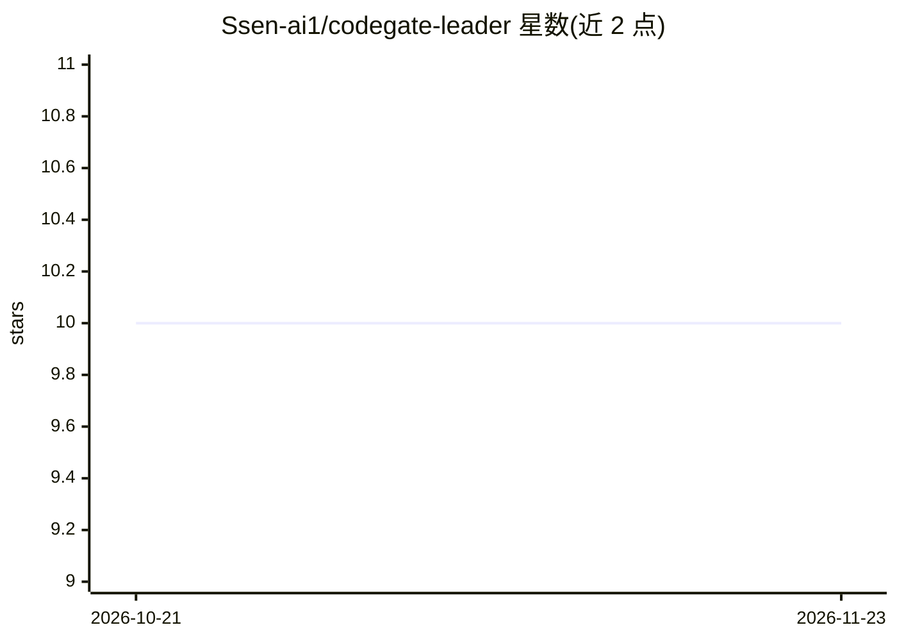

# Ssen-ai1/codegate-leader

⭐ 10 · TypeScript · Apache-2.0 · 推送 2026-08-25 · [GitHub](https://github.com/Ssen-ai1/codegate-leader) · [官网](https://github.com/Ssen-ai1/codegate-leader#readme) · 个人维护 · 中文 README

**本地技术负责人工作台：为 Coding Agent 管理需求、计划与证据审查**

Electron 桌面应用与 CLI，在用户与 Codex、Claude Code 等 Coding Agent 之间提供需求澄清、架构决策记录、动态计划、Prompt 编译、执行基线对比与证据审查。核心机制包括 TaskSpec/ADR/Handoff 等版本化工件、按步交接的受控 Prompt、重新读取工作区并运行验证命令的可信审查。不配置模型也可使用解析、计划与证据审查；当前为 Alpha，Windows 安装包未签名。

## 筛选速览

| 维度 | 判定 | 备注 |
|---|---|---|
| AI 角色 | `ai-ecosystem` | LLM/agent 周边工具 |
| 许可风险 | `permissive` | Apache-2.0 |
| 部署形态 | `None` |  |
| 模型依赖 | — | README 未给出锁定关系 |
| 硬件要求 | — | 无带数字的原话,不猜 |
| 安装摩擦 | `low` | 无编译、无系统依赖或容器化 |
| 成熟度 | `idea` | |

## 能力要点

- 需求/架构/计划/交接/审查七阶段流程，工件可恢复与审计
- Handoff 前保存 Git/文件基线，区分本轮与历史改动
- Evidence Review 重新运行验证命令，不采信 Agent 自报完成
- 支持产品开发与 FPGA 竞赛两种模式，可解析 PDF/Word/图片赛题

## 适用场景

- 从一句产品想法推进到计划、Agent 执行与验证交付
- 学生团队拆解 FPGA 赛题并生成冲刺计划与答辩材料
- 长任务中逐步交接给 Codex/Claude Code 并核验证据

## 场景标签

`编码 Agent` `代码审查` `代码生成` `文档解析` · 领域:编码与开发

## 证据(README 行号)

> L4:  一个独立于模型与 Agent 的本地技术负责人工作台：需求澄清、架构决策、动态计划、Agent Prompt、真实证据审查与纠偏。
> L25: CodeGate Leader 在用户与 Coding Agent 之间增加一个稳定的“技术负责人层”。它不替代 Agent，也不盲目自动执行代码，而是把目标、决策、计划和证据沉淀成可恢复、可审计的工程工件。
> L41: |模型与 Agent 解耦|Leader 模型、Reviewer 模型和执行 Agent 可以分别配置|可在 Codex、Claude Code及兼容模型之间切换|

## 星数曲线

2026-10-21 10 → 2026-11-23 10（+0）

---
*卡片 v1 · prompt 1.4 · 生成 2026-11-20 · 置信度 high · 依据 README sha `1b277202433a` · [字段定义](../../DATASET.md)*
