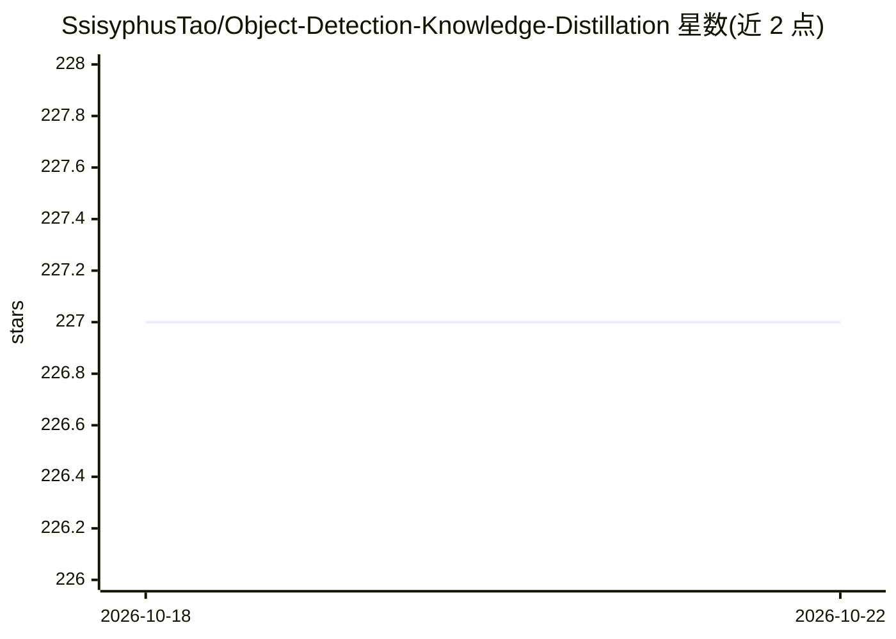

# SsisyphusTao/Object-Detection-Knowledge-Distillation

⭐ 227 · Python · GPL-3.0 · 推送 2026-10-10 · [GitHub](https://github.com/SsisyphusTao/Object-Detection-Knowledge-Distillation) · 个人维护

**基于 PyTorch 的目标检测知识蒸馏框架（SSD/YOLOv5）**

以 PyTorch 实现的知识蒸馏框架，面向目标检测模型压缩：主分支包含 SSD-lite 蒸馏实现（复现 Chen, G. et al. 2017 论文方法），SSD 与 YOLOv5 蒸馏需查看其他分支。通过 setup.py 安装后提供 odkd-train 训练命令，按 YAML 配置文件运行。作者声明主分支功能不完整，评估模块、LOG 模块、COCO 数据集支持与 YOLOv5 蒸馏列入 TODO。README 提供面向初学者的指导。

## 筛选速览

| 维度 | 判定 | 备注 |
|---|---|---|
| AI 角色 | `ai-native` | 本体是模型或模型工具 |
| 许可风险 | `viral` | GPL-3.0 |
| 部署形态 | `None` |  |
| 模型依赖 | — | README 未给出锁定关系 |
| 硬件要求 | — | 无带数字的原话,不猜 |
| 安装摩擦 | `low` | 无编译、无系统依赖或容器化 |
| 成熟度 | `idea` | |

## 能力要点

- SSD-lite 蒸馏实现（复现 Chen, G. et al. 2017）
- 提供 odkd-train 命令行训练工具，按 YAML 配置运行
- SSD 与 YOLOv5 蒸馏分布在其他分支

## 适用场景

- 研究目标检测模型的知识蒸馏方法
- 复现 SSD 知识蒸馏论文并进行模型压缩实验
- 初学者学习知识蒸馏代码实现

## 场景标签

`目标检测` `模型量化` · 领域:感知与多模态

## 证据(README 行号)

> L14: 1. The first edition is the refactor of branch mbv2-lite, which is an implementation of Chen, G. et al. (2017) ‘Lea
> L26: $ python setup.py install --user

## 星数曲线

2026-10-18 227 → 2026-10-22 227（+0）

---
*卡片 v1 · prompt 1.4 · 生成 2026-10-22 · 置信度 high · 依据 README sha `ef23fdd508bf` · [字段定义](../../DATASET.md)*
