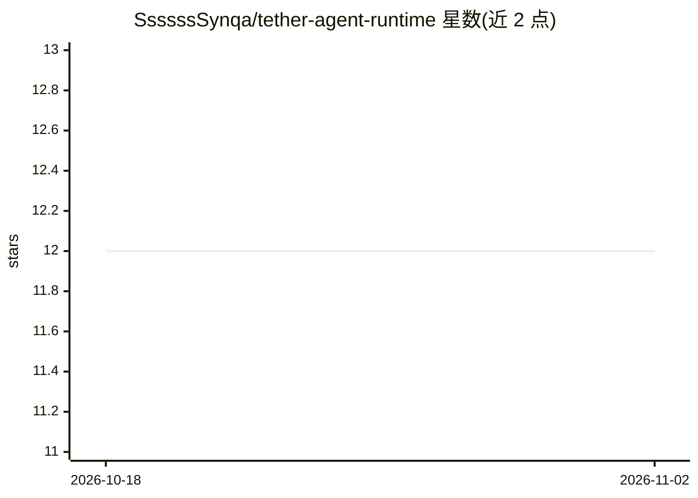

# SsssssSynqa/tether-agent-runtime

⭐ 12 · JavaScript · Apache-2.0 · 推送 2026-10-28 · [GitHub](https://github.com/SsssssSynqa/tether-agent-runtime) · 个人维护 · 中文 README

**本地优先的 agent 运行时：为纯 API agent 提供跨通道连续会话与分层记忆**

面向仅暴露 OpenAI 兼容 Chat Completions API 的 agent：将其接入终端与 Telegram 私聊/白名单群组，共享一条权威会话。内置分层记忆：persona 策略文件、按 token 水位自动折叠的活跃上下文、按运行日结算的日卡/周卡、可选语义抽取与向量召回；另带只读双语 Web 控制台查看记忆与队列。交付层提供持久入队、有序重放、崩溃恢复与死信清单；失败时倾向阻断而非伪造连续性。要求 Node.js 20+，从源码运行，数据全部留在本地文件夹。

## 筛选速览

| 维度 | 判定 | 备注 |
|---|---|---|
| AI 角色 | `ai-ecosystem` | LLM/agent 周边工具 |
| 许可风险 | `permissive` | Apache-2.0 |
| 部署形态 | `None` |  |
| 模型依赖 | — | README 未给出锁定关系 |
| 硬件要求 | — | 无带数字的原话,不猜 |
| 安装摩擦 | `low` | 无编译、无系统依赖或容器化 |
| 成熟度 | — | 结构信号不足 |

## 能力要点

- 终端与 Telegram 共享同一条权威会话
- token 驱动的自动折叠 + 日卡/周卡长期记忆
- 持久交付、有序重放与监督重启等运维层
- 双语只读 Web 控制台展示实际编译的上下文

## 适用场景

- 让纯 API agent 在手机与终端保持同一身份和记忆
- 为聊天 agent 建立可审计的长期叙事记忆
- 跨 provider 切换时保持会话与记忆不中断

## 场景标签

`Agent 记忆` · 领域:Agent 开发

## 证据(README 行号)

> L3: Tether is a local-first agent runtime that preserves one continuous identity across channels, provider changes, cras
> L10: All it takes is an API: Tether puts your agent on Telegram and in your local terminal at the same time — one sessio
> L53: Any API that implements the documented OpenAI-compatible Chat Completions/Embeddings subset can be configured direc

## 星数曲线

2026-10-18 12 → 2026-11-02 12（+0）

---
*卡片 v1 · prompt 1.4 · 生成 2026-11-01 · 置信度 high · 依据 README sha `2f155e435366` · [字段定义](../../DATASET.md)*
