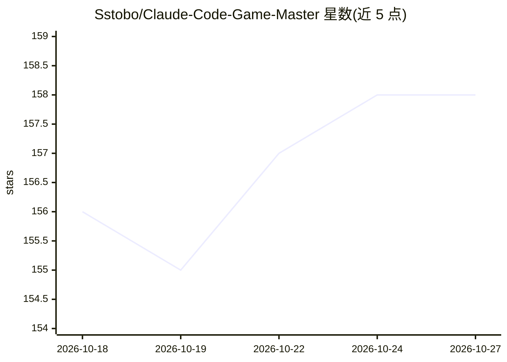

# Sstobo/Claude-Code-Game-Master

⭐ 158 · Python · NOASSERTION · 推送 2026-08-16 · [GitHub](https://github.com/Sstobo/Claude-Code-Game-Master) · 个人维护

**把 Claude Code 变成持久跑团游戏主持人的运行框架**

围绕 Claude Code 构建的薄壳 harness，将模型改造为持续运行的游戏主持人（GM）。核心机制：战役状态以 JSON 持久化到磁盘并先写后叙述，使故事跨会话/跨机器延续；按需加载规则而非常驻上下文；用本地检索索引（RAG）从导入的 PDF 原著或自建世界设定中取材叙述。支持两条路径：问卷生成原创世界（含自定义规则包），或导入书籍 PDF 游玩。需 Claude Code 作为前置，macOS/Linux 经安装脚本运行。

## 筛选速览

| 维度 | 判定 | 备注 |
|---|---|---|
| AI 角色 | `ai-native` | 本体是模型或模型工具 |
| 许可风险 | `none` | NOASSERTION |
| 部署形态 | `None` |  |
| 模型依赖 | locked-api |  |
| 硬件要求 | — | 无带数字的原话,不猜 |
| 安装摩擦 | `low` | 无编译、无系统依赖或容器化 |
| 成熟度 | — | 结构信号不足 |

## 能力要点

- 战役状态以纯 JSON 持久化，先写盘后叙述，支持跨会话/跨机器续玩
- 本地检索索引从导入书籍或自建正典中取材，按需加载自定义规则包
- 原创世界生成管线（问卷→种子→骨架→开局包）与反套路流水线
- 按需启动的专业子代理（怪物手册/施法/装备/场景插画）

## 适用场景

- 把喜欢的小说 PDF 导入后在其中扮演角色跑持久战役
- 通过问卷生成一个原创规则体系的桌面跑团世界
- 希望 GM 记住数周前剧情存档的长期角色扮演

## 场景标签

 · 领域:游戏/交互叙事

## 证据(README 行号)

> L3: **A harness that turns Claude Code into a persistent Game Master — a holodeck door and a fresh 1980s D&D table.**
> L7: This is not a chatbot you roleplay with. It's a *harness*: a thin, opinionated shell around Claude Code that gives t
> L27: Every turn runs the same loop: **gather context → decide → execute → persist state → narrate.** The harness enforce

## 星数曲线

2026-10-18 156 → 2026-10-27 158（+2）

---
*卡片 v1 · prompt 1.4 · 生成 2026-10-22 · 置信度 high · 依据 README sha `acb886f19856` · [字段定义](../../DATASET.md)*
