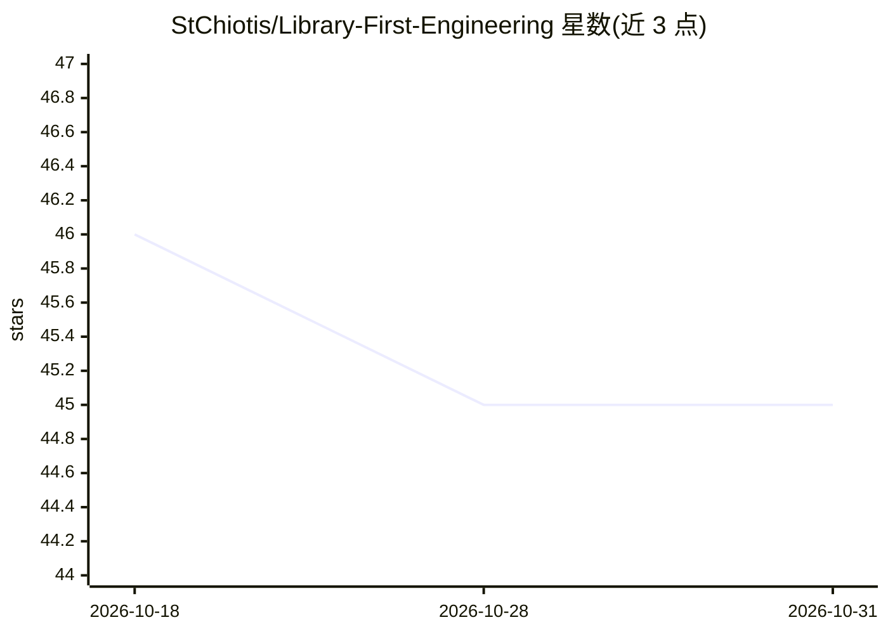

# StChiotis/Library-First-Engineering

⭐ 45 · MIT · 推送 2026-07-14 · [GitHub](https://github.com/StChiotis/Library-First-Engineering) · [官网](https://github.com/StChiotis/Library-First-Engineering#-what-is-library-first-engineering) · 个人维护

**文件驱动的 AI agent 协作流程框架：用结构化流水线约束 AI 编码**

Library-First Engineering（LFE）是一个面向 AI 辅助软件开发的流程框架（模板仓库形式），不是库或 CLI。它通过角色锁定的装配线（Architect → Builder → Inspector → Archivist）与文件化协调层（.plans/ 短期、.docs/ 长期）组织人机协作，针对逻辑幻觉、上下文衰减与架构熵增三类失败模式。语言/IDE/LLM 无关，兼容 ChatGPT、Claude.ai 等原始 LLM 对话界面（粘贴 system_prompt.txt 适配器）。使用方式为 GitHub 模板或 git clone，无独立安装包。

## 筛选速览

| 维度 | 判定 | 备注 |
|---|---|---|
| AI 角色 | `ai-ecosystem` | LLM/agent 周边工具 |
| 许可风险 | `permissive` | MIT |
| 部署形态 | `None` |  |
| 模型依赖 | — | README 未给出锁定关系 |
| 硬件要求 | — | 无带数字的原话,不猜 |
| 安装摩擦 | `low` | 无编译、无系统依赖或容器化 |
| 成熟度 | — | 结构信号不足 |

## 能力要点

- 角色工具锁定：Architect 不能改代码、Builder 不能改计划等
- .plans/ 短期协调层与 .docs/ 长期知识库的两层记忆模型
- 崩溃后按文件状态恢复会话，不依赖聊天上下文
- 用户仅需 5 个命令，其余由框架在装配线内调度

## 适用场景

- 用 AI agent 做生产级软件开发时约束流程与产出
- 多贡献者/多 agent 项目的知识沉淀与可恢复协作
- 降低长会话中 AI 编码的上下文漂移与返工成本

## 场景标签

`Agent 框架` `多智能体` · 领域:Agent 开发

## 证据(README 行号)

> L7:  A file-driven, persona-based framework for building production software with AI agents.
> L34: **Library-First Engineering (LFE)** is a process framework — not a library, not a CLI, not a config file. It forces

## 星数曲线

2026-10-18 46 → 2026-10-31 45（-1）

---
*卡片 v1 · prompt 1.4 · 生成 2026-10-25 · 置信度 high · 依据 README sha `577b18f9deeb` · [字段定义](../../DATASET.md)*
