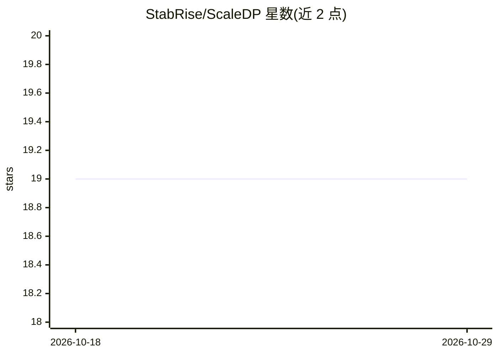

# StabRise/ScaleDP

⭐ 19 · Python · AGPL-3.0 · 推送 2026-09-27 · [GitHub](https://github.com/StabRise/ScaleDP) · [官网](https://stabrise.com/scaledp/) · 组织维护

**基于 Apache Spark 的 AI/ML 文档处理库：OCR+LLM 提取结构化数据**

Python 库，把 PDF/图像读入 Spark DataFrame，结合 OCR 引擎（Tesseract/EasyOCR/Surya/DocTR/Vision LLM）与 LLM/VLM、Hugging Face NLP 模型做文本抽取、零样本结构化数据提取、NER 与目标检测，并以 Spark 实现规模化处理。支持 OpenAI 兼容 API 调用 LLM/VLM，可脱离 Spark Session 以 REST API 运行，支持流式实时处理。面向需要在 Spark 环境中批量处理文档的开发者，要求 Python 3.10+、Spark 3.5+ 与 Java 8。

## 筛选速览

| 维度 | 判定 | 备注 |
|---|---|---|
| AI 角色 | `ai-native` | 本体是模型或模型工具 |
| 许可风险 | `viral` | AGPL-3.0 |
| 部署形态 | `self-host` | docker 或自建部署 |
| 模型依赖 | — | README 未给出锁定关系 |
| 硬件要求 | — | 无带数字的原话,不猜 |
| 安装摩擦 | `low` | 无编译、无系统依赖或容器化 |
| 成熟度 | — | 结构信号不足 |

## 能力要点

- PDF/图像加载到 Spark DataFrame 并抽取文本/图像
- 零样本结构化数据提取（LLM/VLM，Pydantic 定义 schema）
- 5 类 OCR 引擎可选（含 Vision LLM OCR），附性能对比表
- 支持流式处理与无 Spark Session 的 REST API 低延迟模式

## 适用场景

- 在 Spark 集群上批量 OCR 与抽取发票等文档的结构化字段
- 用 Vision LLM 对图像/PDF 做零样本数据提取
- 对扫描件做 NER 并可视化标注结果

## 场景标签

`OCR` `文档解析` `目标检测` · 领域:知识与检索

## 证据(README 行号)

> L26: ScaleDP is library allows you to process documents using AI/ML capabilities and scale it using Apache Spark.
> L38: - ✅ Zero-Shot extraction **structured data** from text/images using LLM and ML models

## 星数曲线

2026-10-18 19 → 2026-10-29 19（+0）

---
*卡片 v1 · prompt 1.4 · 生成 2026-10-28 · 置信度 high · 依据 README sha `00f0372f04ad` · [字段定义](../../DATASET.md)*
