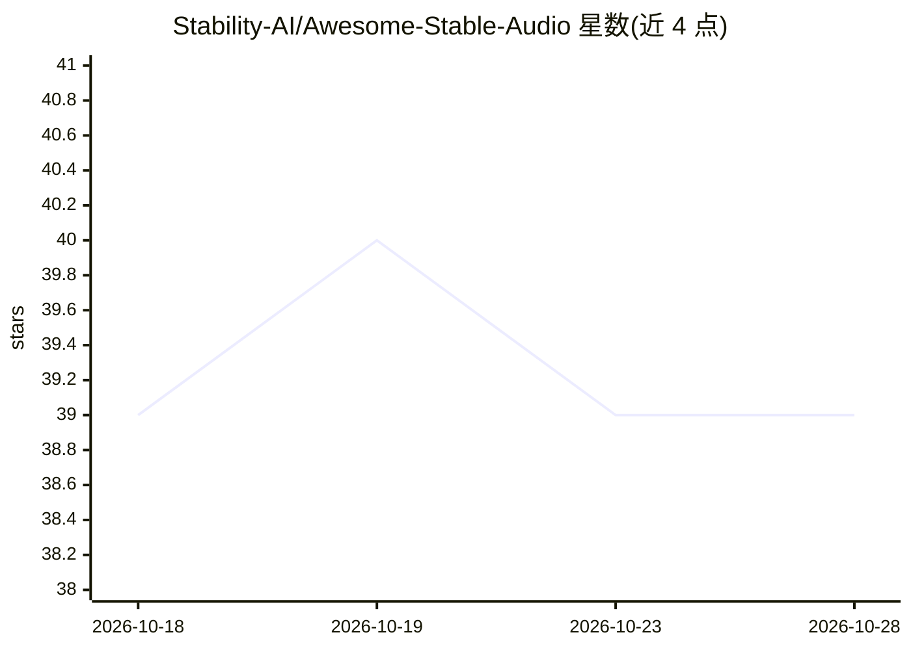

# Stability-AI/Awesome-Stable-Audio

⭐ 39 · 推送 2026-10-14 · [GitHub](https://github.com/Stability-AI/Awesome-Stable-Audio) · 组织维护

**Stable Audio 生态项目与资源策展清单**

由 Stability-AI 维护的 Stable Audio 音频生成模型生态聚合清单：收录官方资源（训练推理仓库、API、HuggingFace 权重与在线演示）、ComfyUI/Fal 等平台集成、社区 LoRA 微调项目，以及三十余个社区作品（C++ 原生运行时 sa3.cpp、DAW 插件、Ableton 扩展、离线桌面应用、Max/MSP 包、实时演出工具等），并按年份整理相关论文。面向音频生成开发者和音乐制作用户查阅。

## 筛选速览

| 维度 | 判定 | 备注 |
|---|---|---|
| AI 角色 | `ai-knowledge` | 知识聚合/清单类 |
| 许可风险 | `none` | — |
| 部署形态 | `None` |  |
| 模型依赖 | — | README 未给出锁定关系 |
| 硬件要求 | — | 无带数字的原话,不猜 |
| 安装摩擦 | `low` | 无编译、无系统依赖或容器化 |
| 成熟度 | — | 结构信号不足 |

## 能力要点

- 覆盖官方仓库、API、HuggingFace 权重与文档的官方资源表
- 收录 ComfyUI/Fal 集成与社区 LoRA 微调项目
- 整理 2024-2026 年 Stable Audio 相关论文列表
- 社区板块含原生运行时、DAW 插件、离线桌面应用等三十余个作品

## 适用场景

- 查找 Stable Audio 模型的官方权重、文档与 API 入口
- 为音乐制作工作流寻找 Stable Audio 的 DAW/VST 插件与本地运行方案
- 跟踪 Stable Audio 相关论文与社区微调项目

## 场景标签

`精选清单` · 领域:学习与行业

## 证据(README 行号)

> L2: > A curated list of projects, tools, models, UIs, and resources for **Stable Audio**. Contributions welcome!
> L1: # Awesome Stable Audio Awesome

## 星数曲线

2026-10-18 39 → 2026-10-28 39（+0）

---
*卡片 v1 · prompt 1.4 · 生成 2026-10-25 · 置信度 high · 依据 README sha `97535895109f` · [字段定义](../../DATASET.md)*
