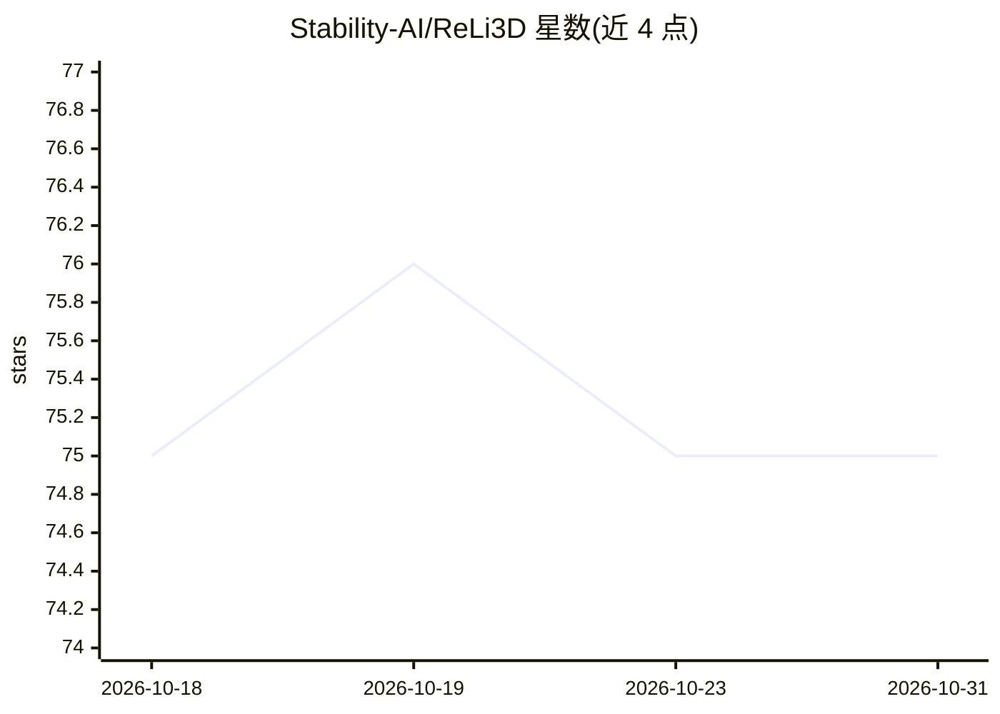

# Stability-AI/ReLi3D

⭐ 75 · Python · NOASSERTION · 推送 2026-07-02 · [GitHub](https://github.com/Stability-AI/ReLi3D) · 组织维护

**从多视角图像重建可重光照 3D 资产的推理库**

Stability AI 发布的仅推理代码库：输入物体多视角图像（RGBA 帧）与相机位姿（transforms.json），预测 UV 展开的纹理网格、材质属性与估计光照，输出 mesh.glb、illumination.hdr 与 run_info.json。模型权重托管于 Hugging Face（StabilityLabs/ReLi3D），支持显式下载或推理时自动下载，可指定 checkpoint/config 路径以复现最终运行。仓库刻意排除训练与实验流程，代码与模型受 Stability AI Community License 约束。论文发表于 ICLR 2026。

## 筛选速览

| 维度 | 判定 | 备注 |
|---|---|---|
| AI 角色 | `ai-native` | 本体是模型或模型工具 |
| 许可风险 | `none` | NOASSERTION |
| 部署形态 | `None` |  |
| 模型依赖 | — | README 未给出锁定关系 |
| 硬件要求 | — | 无带数字的原话,不猜 |
| 安装摩擦 | `low` | 无编译、无系统依赖或容器化 |
| 成熟度 | — | 结构信号不足 |

## 能力要点

- 多视角图像+相机位姿 → UV 纹理网格、材质属性与光照估计
- 模型权重托管 Hugging Face，支持显式/自动下载与路径解析（CLI 参数/环境变量/本地路径）
- 仅推理发布，训练与实验流程不在仓库内
- 输出 mesh.glb、illumination.hdr 与 run_info.json（避免泄露绝对路径）

## 适用场景

- 从多视角照片重建可重光照的 3D 资产（含 PBR 材质）
- 为 3D 内容管线生成带材质与光照分解的网格模型
- 复现论文 ReLi3D 的推理结果

## 场景标签

`图像视频处理` `推理引擎` · 领域:感知与多模态

## 证据(README 行号)

> L14: ReLi3D is an inference-only release for relightable 3D asset reconstruction.
> L16: Given a set of object images and camera poses (`transforms.json` + RGBA frames), ReLi3D predicts a UV-unwrapped tex

## 星数曲线

2026-10-18 75 → 2026-10-31 75（+0）

---
*卡片 v1 · prompt 1.4 · 生成 2026-10-24 · 置信度 high · 依据 README sha `8473425d8525` · [字段定义](../../DATASET.md)*
