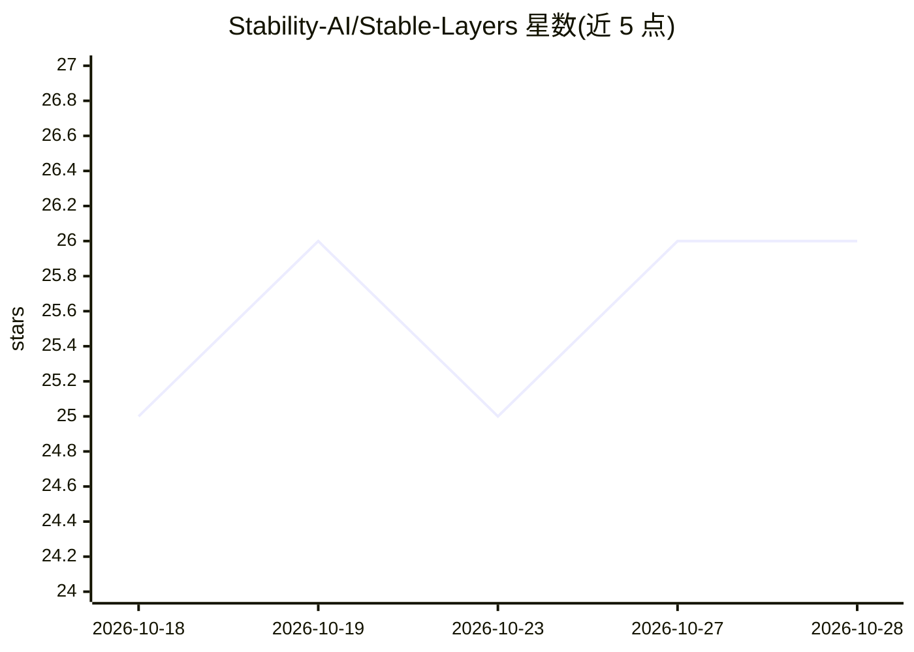

# Stability-AI/Stable-Layers

⭐ 26 · Python · NOASSERTION · 推送 2026-07-23 · [GitHub](https://github.com/Stability-AI/Stable-Layers) · 组织维护

**将单张 RGB 图像分解为可编辑 RGBA 图层的推理模型**

Stability-AI 发布的推理专用模型代码库：将单张 RGB 图像分解为背景加若干对象的由后至前 RGBA 图层堆栈，供合成与编辑使用。模型为基于 Qwen/Qwen-Image-Layered 的 LoRA 适配器，以 Qwen 3.5 9b 为 VLM 教师训练。提供 decompose.py 入口处理单图或目录，基础模型从 Hugging Face 自动拉取，LoRA 权重内置。需要一块 GPU（基础模型 bf16 约 40 GB，建议 A100-80/H100/H200 级显卡）。推荐设置为 Heun 采样器、50 步、640 px、4 层。采用 Stability AI Community License。

## 筛选速览

| 维度 | 判定 | 备注 |
|---|---|---|
| AI 角色 | `ai-native` | 本体是模型或模型工具 |
| 许可风险 | `none` | NOASSERTION |
| 部署形态 | `library` | 以包/库形式分发 |
| 模型依赖 | — | README 未给出锁定关系 |
| 硬件要求 | — | 无带数字的原话,不猜 |
| 安装摩擦 | `low` | 无编译、无系统依赖或容器化 |
| 成熟度 | — | 结构信号不足 |

## 能力要点

- 单图分解为背景+对象层的 RGBA 图层堆栈
- 基于 Qwen-Image-Layered 的 LoRA 适配器，权重内置且可从 HuggingFace 覆盖
- 噪声按 seed+image_index 播种，同输入可复现同输出
- 默认白底合成，--transparent 输出带真实 alpha 的 RGBA

## 适用场景

- 把照片拆成图层后导入编辑器做合成或修改
- 批量处理目录中的图像生成可编辑图层
- 生成用于图像合成管线的分层素材

## 场景标签

`图像生成` · 领域:内容生成

## 证据(README 行号)

> L14: This is an inference-only release of **Stable Layers**, a model that decomposes a
> L18: The model is a LoRA adapter over `Qwen/Qwen-Image-Layered`. This model was trained

## 星数曲线

2026-10-18 25 → 2026-10-28 26（+1）

---
*卡片 v1 · prompt 1.4 · 生成 2026-10-27 · 置信度 mid · 依据 README sha `d8d75fbf063f` · [字段定义](../../DATASET.md)*
