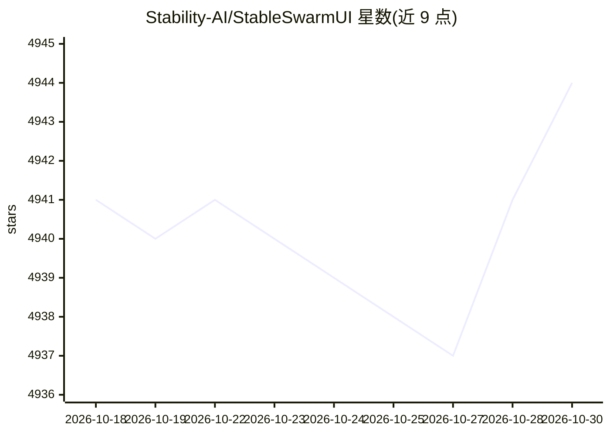

# Stability-AI/StableSwarmUI

⭐ 4,944 · C# · MIT · 推送 2026-10-15 · [GitHub](https://github.com/Stability-AI/StableSwarmUI) · 组织维护

**模块化 Stable Diffusion 网页界面，已停维并迁移至 SwarmUI**

面向 Stable Diffusion 图像生成的 Web 用户界面：提供 Generate 主标签页与 Comfy Workflow 原始图表面板，支持图片编辑器、自动工作流生成、Grid Generator 等工具；后端可选 ComfyUI（可自动安装）、AUTOMATIC1111 WebUI 或 Stability AI API，名称源自多 GPU 并行生成功能。Windows/Linux 提供安装脚本，Mac 仅限 M1/M2 Apple Silicon，另有 Docker 运行方式。README 明确声明自 2024/06/21 起 Stability AI 不再维护，原开发者以 mcmonkeyprojects/SwarmUI 独立续作，此仓库版本为 0.6.4.1 Beta。

## 筛选速览

| 维度 | 判定 | 备注 |
|---|---|---|
| AI 角色 | `ai-native` | 本体是模型或模型工具 |
| 许可风险 | `permissive` | MIT |
| 部署形态 | `desktop` | 安装包/桌面程序 |
| 模型依赖 | — | README 未给出锁定关系 |
| 硬件要求 | — | 无带数字的原话,不猜 |
| 安装摩擦 | `medium` | 含编译或系统依赖之一 |
| 成熟度 | `idea` | |

## 能力要点

- Generate 与 Comfy Workflow 双界面，覆盖新手与进阶用户
- 多后端：ComfyUI（可自动安装）、AUTOMATIC1111、Stability AI API
- 多 GPU 并行生成（swarm）与 Grid Generator 等工具
- 提供 Windows/Linux 安装脚本、Mac 脚本与 Docker 启动方式

## 适用场景

- 通过浏览器界面生成与编辑 Stable Diffusion 图像
- 用多 GPU 并行跑大批量网格生成
- 在 ComfyUI 图表面板中搭建自定义工作流

## 场景标签

`图像生成` · 领域:内容生成

## 证据(README 行号)

> L5: A Modular Stable Diffusion Web-User-Interface, with an emphasis on making powertools easily accessible, high perform
> L141: The overall goal of StableSwarmUI is to a be full-featured one-stop-shop for all things Stable Diffusion.

## 星数曲线

2026-10-18 4,941 → 2026-10-30 4,944（+3）

---
*卡片 v1 · prompt 1.4 · 生成 2026-10-20 · 置信度 high · 依据 README sha `3a354c3544be` · [字段定义](../../DATASET.md)*
