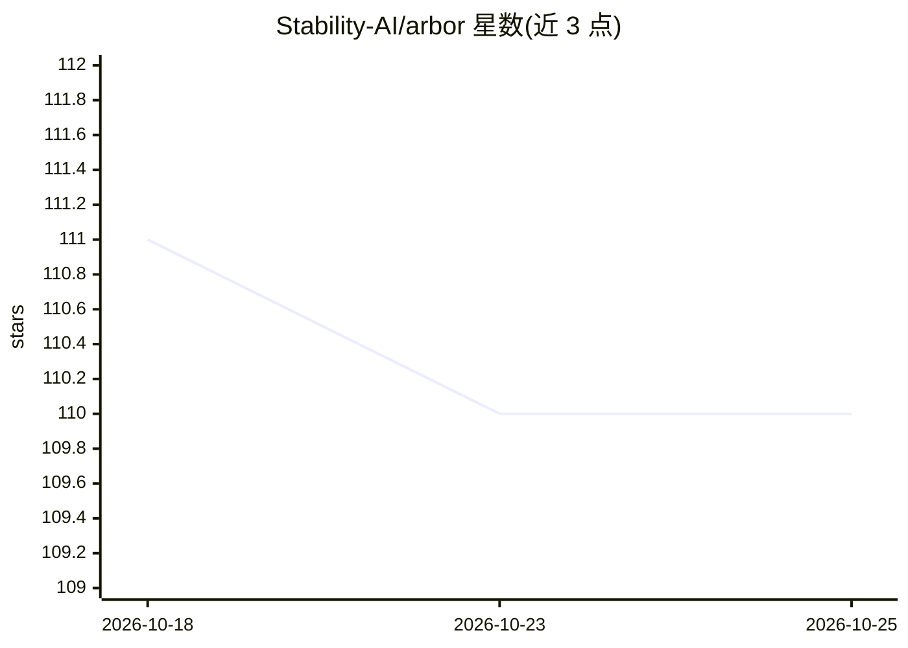

# Stability-AI/arbor

⭐ 110 · Python · MIT · 推送 2026-06-22 · [GitHub](https://github.com/Stability-AI/arbor) · [官网](https://arbor.jdihlmann.com) · 组织维护

**带显式几何约束的文生 3D 资产生成管线**

Stability AI 发布的推理专用 text-to-3D 生成工具：用户提供提示词与约束网格（hull 占据、avoidance 避让、touch 接触三类信号），Arbor 生成遵循约束的 3D 资产，最终输出使用 TRELLIS mesh decoder。含推理 CLI、Python API、Blender 插件与条件指标评估工具（arbor-evaluate 计算 hull 重叠、避让违规、接触等指标）；不含训练代码与基准启动器。要求 Linux + NVIDIA GPU，参考环境为 Python 3.10、PyTorch 2.4.0、CUDA 11.8。模型文件托管于 Hugging Face（StabilityLabs/arbor），采用 Stability AI Community License。

## 筛选速览

| 维度 | 判定 | 备注 |
|---|---|---|
| AI 角色 | `ai-native` | 本体是模型或模型工具 |
| 许可风险 | `permissive` | MIT |
| 部署形态 | `desktop` | 安装包/桌面程序 |
| 模型依赖 | — | README 未给出锁定关系 |
| 硬件要求 | — | 无带数字的原话,不猜 |
| 安装摩擦 | `medium` | 含编译或系统依赖之一 |
| 成熟度 | — | 结构信号不足 |

## 能力要点

- hull/avoidance/touch 三类显式几何约束信号
- 推理 CLI、Python API 与 Blender 插件三种使用方式
- arbor-evaluate 输出条件遵循指标与四视角面板
- 生成结果为 mesh.ply 与稀疏结构占用网格

## 适用场景

- 按指定占位/避让/接触区域生成 3D 资产
- 在 Blender 内直接指定约束网格并提交生成任务
- 对生成结果做条件遵循度评估与迭代调整

## 场景标签

 · 领域:3D 生成/计算机图形学

## 证据(README 行号)

> L15: Arbor is an inference-only release for text-to-3D generation with explicit geometry controls. You provide a prompt 
> L31: The commands below install Arbor, download the public model files, and run a first example. Linux with an NVIDIA GP

## 星数曲线

2026-10-18 111 → 2026-10-25 110（-1）

---
*卡片 v1 · prompt 1.4 · 生成 2026-10-23 · 置信度 high · 依据 README sha `fc7f1ca86dd5` · [字段定义](../../DATASET.md)*
