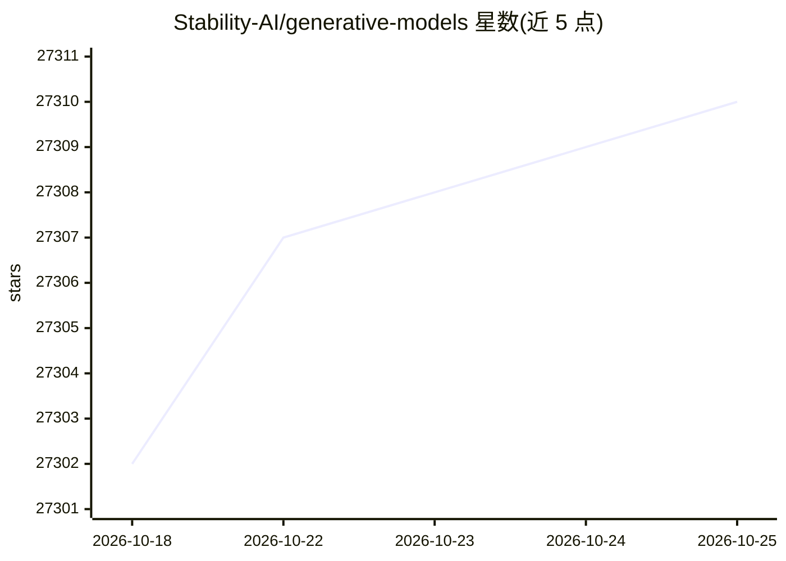

# Stability-AI/generative-models

⭐ 27,312 · Python · MIT · 推送 2025-12-16 · [GitHub](https://github.com/Stability-AI/generative-models) · 组织维护

**Stability AI 的开源生成模型仓库：SV4D/SV3D/SVD/SDXL**

Stability AI 发布多代生成模型的官方代码库，以 News 形式按时间累积收录：SV4D 2.0（视频到 4D 新视角合成）、SV4D、SV3D（单图生成多视角轨道视频）、SDXL-Turbo、Stable Video Diffusion、SDXL 系列等，均注明面向研究用途。代码库采用配置驱动架构，通过 yaml 配置中的 instantiate_from_config() 组合子模块；训练基于 PyTorch Lightning，推理提供 streamlit demo、独立 python 脚本与社区 gradio demo。模型权重从 HuggingFace 下载，部分早期模型需通过组织邮箱申请访问。

## 筛选速览

| 维度 | 判定 | 备注 |
|---|---|---|
| AI 角色 | `ai-native` | 本体是模型或模型工具 |
| 许可风险 | `permissive` | MIT |
| 部署形态 | `library` | 以包/库形式分发 |
| 模型依赖 | — | README 未给出锁定关系 |
| 硬件要求 | — | 无带数字的原话,不猜 |
| 安装摩擦 | `medium` | 含编译或系统依赖之一 |
| 成熟度 | — | 结构信号不足 |

## 动量与使用信号

- 维护:`declining` — 距上次 push 306.0 天,年发版 0,19 位贡献者
- 涨星:近 1 天 **-3**(自 20261016 起算)
- 安装:pypi 包 `torch` 月下载 58,964,343

## 能力要点

- SV4D 2.0 视频到 4D 扩散模型：12 帧输入生成 48 帧（12 帧 x 4 视角）576x576 输出，支持自回归生成更长视频
- 低显存运行选项：--encoding_t=1、--decoding_t=1 或降低分辨率 --img_size=512
- 配置驱动的模块化代码库：yaml 配置组合子模块，guiders 与 samplers 分离且独立于模型
- 提供 streamlit demo、独立推理脚本与社区 gradio demo 多种运行入口

## 适用场景

- 从单个视频生成多视角 novel-view 视频与 4D 资产
- 从单张图片生成轨道式多视角视频
- 运行 SDXL、SVD 等已发布模型的推理与研究复现

## 场景标签

`图像生成` `视频生成` `推理引擎` · 领域:内容生成

## 证据(README 行号)

> L1: # Generative Models by Stability AI
> L152: Modularity is king. This repo implements a config-driven approach where we build and combine submodules by
> L157: For training, we use PyTorch Lightning, but it should be easy to use other

## 星数曲线

2026-10-18 27,302 → 2026-10-25 27,310（+8）

---
*卡片 v1 · prompt 1.4 · 生成 2026-10-18 · 置信度 high · 依据 README sha `bbb7b6854315` · [字段定义](../../DATASET.md)*
