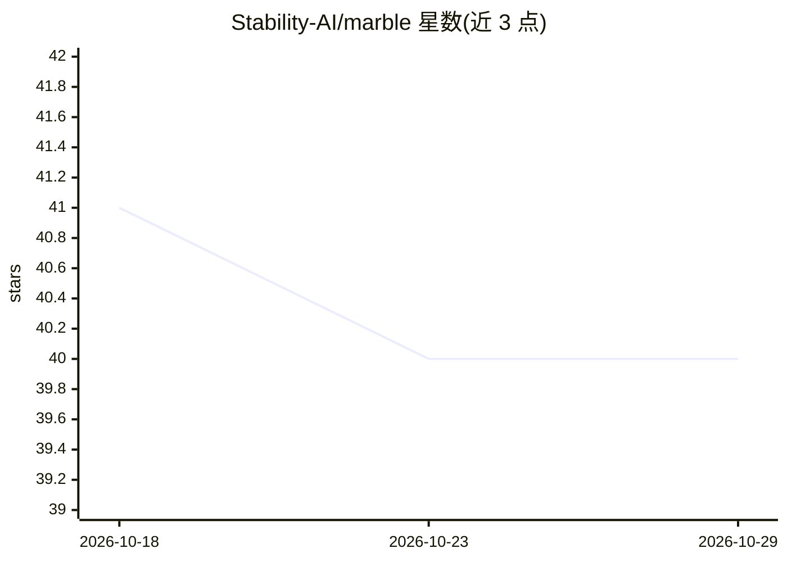

# Stability-AI/marble

⭐ 40 · Python · NOASSERTION · 推送 2026-05-08 · [GitHub](https://github.com/Stability-AI/marble) · 组织维护

**图像材质迁移/混合/参数化编辑的官方实现（CVPR 2025）**

MARBLE（Material Recomposition and Blending in CLIP-Space）的官方代码实现：给定输入图像，支持材质迁移、材质混合与多属性参数化控制三类编辑。材质模块基于 InstantStyle 代码库构建，在 ip_adapter_instantstyle/ip_adapter.py 中扩展功能。提供 Jupyter notebook 示例、Gradio 演示与 ComfyUI 自定义节点。在 Python 3.9.7 上测试，需 git clone 源码并安装依赖后使用。

## 筛选速览

| 维度 | 判定 | 备注 |
|---|---|---|
| AI 角色 | `ai-native` | 本体是模型或模型工具 |
| 许可风险 | `none` | NOASSERTION |
| 部署形态 | `library` | 以包/库形式分发 |
| 模型依赖 | — | README 未给出锁定关系 |
| 硬件要求 | — | 无带数字的原话,不猜 |
| 安装摩擦 | `low` | 无编译、无系统依赖或容器化 |
| 成熟度 | — | 结构信号不足 |

## 能力要点

- CLIP 空间中的材质迁移、混合与参数化控制
- 提供 try_blend.ipynb 与 parametric_control.ipynb 示例及 Gradio 演示
- 提供 ComfyUI 自定义节点与示例工作流
- 材质模块基于 InstantStyle 代码库扩展

## 适用场景

- 把参考图的材质迁移到输入图像上
- 混合多种材质并做参数化调整
- 在 ComfyUI 工作流中做材质编辑

## 场景标签

`图像生成` · 领域:内容生成

## 证据(README 行号)

> L3: This is the official implementation of MARBLE: Material Recomposition and Blending in CLIP-Space. Given an input ima
> L29: We also provide a gradio demo which can be run with `python gradio_demo.py`.

## 星数曲线

2026-10-18 41 → 2026-10-29 40（-1）

---
*卡片 v1 · prompt 1.4 · 生成 2026-10-25 · 置信度 high · 依据 README sha `766c5f23cff6` · [字段定义](../../DATASET.md)*
