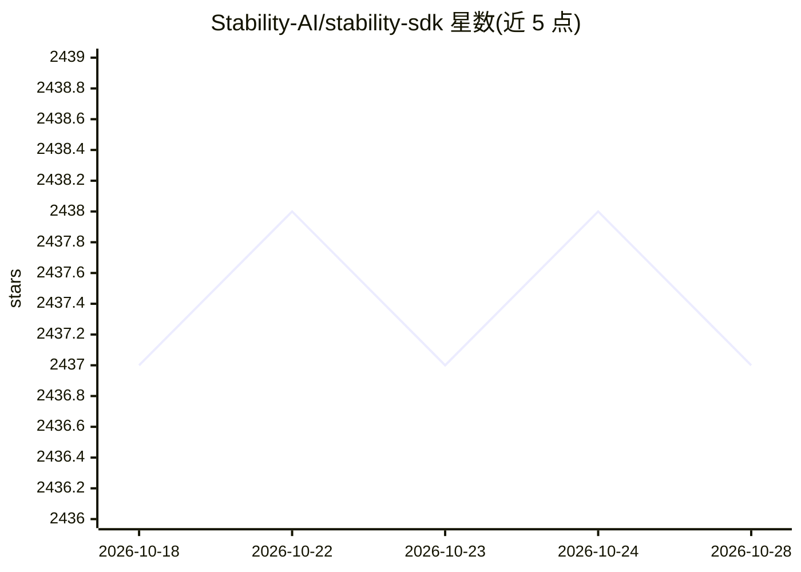

# Stability-AI/stability-sdk

⭐ 2,437 · Jupyter Notebook · MIT · 推送 2026-05-14 · [GitHub](https://github.com/Stability-AI/stability-sdk) · [官网](https://platform.stability.ai/) · 组织维护

**Stability AI 官方 SDK：通过 gRPC API 调用文生图/放大**

Stability-AI 维护的 Python SDK，封装基于 gRPC 的 Stability API：设置 STABILITY_HOST 与 STABILITY_KEY 环境变量后，通过 CLI 生成 PNG 图像、执行图像放大，并支持动画 GUI（可选安装 anim_ui 扩展）。同时提供 protobuf 定义供其他语言编译客户端桩代码，并列出社区贡献的 TypeScript、Ruby、C# 客户端。使用需在 Stability Platform 申请 API key，受 Stability AI API 服务条款约束。

## 筛选速览

| 维度 | 判定 | 备注 |
|---|---|---|
| AI 角色 | `ai-ecosystem` | LLM/agent 周边工具 |
| 许可风险 | `permissive` | MIT |
| 部署形态 | `library` | 以包/库形式分发 |
| 模型依赖 | — | README 未给出锁定关系 |
| 硬件要求 | — | 无带数字的原话,不猜 |
| 安装摩擦 | `low` | 无编译、无系统依赖或容器化 |
| 成熟度 | — | 结构信号不足 |

## 能力要点

- Python 客户端封装 gRPC API，同时可作为命令行工具
- generate 生成 PNG、upscale 图像放大、animate --gui 动画界面
- 提供 protobuf 定义供非 Python 语言编译客户端

## 适用场景

- 在 Python 程序中调用 Stability API 生成图像
- 命令行批量生成或放大图像
- 其他语言开发者基于 protobuf 定义构建 API 客户端

## 场景标签

`图像生成` `图像视频处理` · 领域:内容生成

## 证据(README 行号)

> L5: Client implementations that interact with the Stability API.
> L19: `client.py` is both a command line client and an API class that wraps the gRPC based API. To try the client:

## 星数曲线

2026-10-18 2,437 → 2026-10-28 2,437（+0）

---
*卡片 v1 · prompt 1.4 · 生成 2026-10-21 · 置信度 high · 依据 README sha `4716eb92b24b` · [字段定义](../../DATASET.md)*
