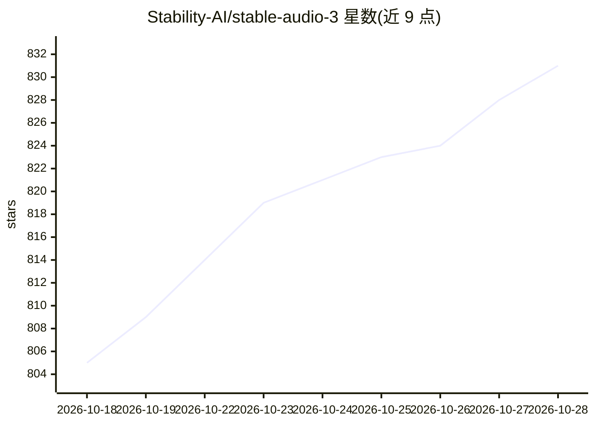

# Stability-AI/stable-audio-3

⭐ 831 · Python · MIT · 推送 2026-10-11 · [GitHub](https://github.com/Stability-AI/stable-audio-3) · 组织维护

**音频/音乐生成开源平台：文本生成音频、编辑与微调**

Stability AI 的音频与音乐生成推理及 LoRA 微调平台，提供 Small-Music/Small-SFX（433M，CPU 可跑）、Medium（1.4B，CUDA/TensorRT）三个本地模型，Large 仅通过 API 提供。支持 text-to-audio、audio-to-audio 编辑、inpainting/续写三种推理模式，配套 SAME 立体声 44.1kHz 自编码器。安装基于 uv，提供 Gradio UI、CLI、Python API，以及 TFLite/MLX/TensorRT 三条优化运行时（MLX 支持纯 MLX LoRA 训练）。Medium 模型需额外安装 Flash Attention 2。

## 筛选速览

| 维度 | 判定 | 备注 |
|---|---|---|
| AI 角色 | `ai-native` | 本体是模型或模型工具 |
| 许可风险 | `permissive` | MIT |
| 部署形态 | `library` | 以包/库形式分发 |
| 模型依赖 | — | README 未给出锁定关系 |
| 硬件要求 | `cpu-ok` | |
| 安装摩擦 | `high` | 编译与系统依赖俱全 |
| 成熟度 | — | 结构信号不足 |

## 能力要点

- 三种推理模式：text-to-audio、audio-to-audio 编辑、inpainting/续写
- Small 模型 CPU 即可运行，无需 GPU；Medium 支持 CUDA/TensorRT
- LoRA 微调能力，可堆叠、运行时可调强度
- TFLite（跨平台 CPU）/MLX（Apple Silicon）/TensorRT（NVIDIA）三条优化运行时，前两条带 Web UI

## 适用场景

- 用文字提示生成音乐或音效素材
- 对现有录音做风格改写或局部重生成/续写
- 在 Apple Silicon 或 CPU 环境本地运行音频生成
- 用自有数据 LoRA 微调出特定风格的模型

## 场景标签

`微调` · 领域:训练与推理

## 证据(README 行号)

> L38: - ⚡ **Fast, state-of-the-art generation** - Generate minutes of audio in milliseconds
> L115: **Text-to-Audio** — Generate audio from a text prompt:

## 星数曲线

2026-10-18 805 → 2026-10-28 831（+26）

---
*卡片 v1 · prompt 1.4 · 生成 2026-10-21 · 置信度 mid · 依据 README sha `6675f54bbd44` · [字段定义](../../DATASET.md)*
