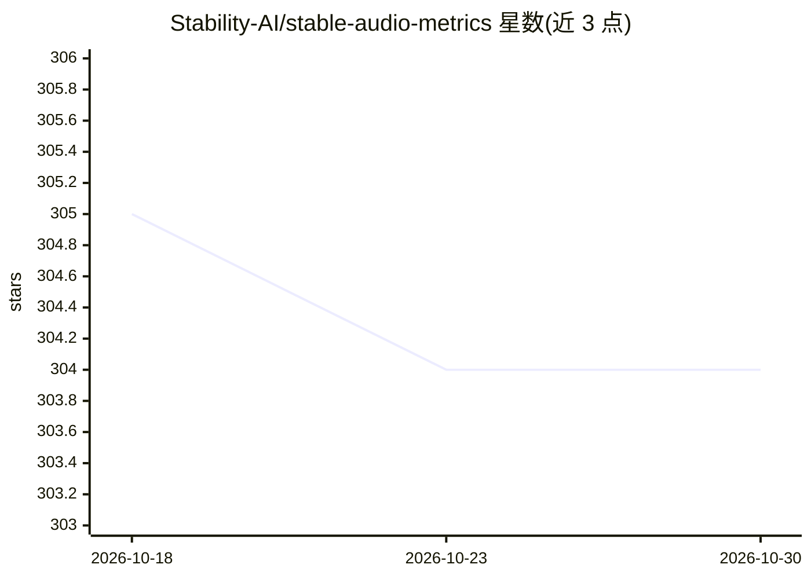

# Stability-AI/stable-audio-metrics

⭐ 304 · Python · MIT · 推送 2026-10-28 · [GitHub](https://github.com/Stability-AI/stable-audio-metrics) · 组织维护

**面向长篇全频段立体声生成模型的音频评测指标集**

Stability-AI 维护的音乐/音频生成模型评测工具：将既有序列适配到长篇、全频段、立体声生成场景，支持可变长度输入。提供三种指标：基于 Openl3 的 48kHz Fréchet Distance、基于 PaSST 的 32kHz KL 散度、基于 CLAP-LAION 的 CLAP 分数。附带 MusicCaps/AudioCaps/Song Describer 数据集示例，no-audio 示例可免下载数据集运行（CLAP 分数除外）。仅支持 GPU 运行，Openl3 依赖可能需要较旧版本 CUDA（如 11.8）。源码克隆方式安装。

## 筛选速览

| 维度 | 判定 | 备注 |
|---|---|---|
| AI 角色 | `ai-ecosystem` | LLM/agent 周边工具 |
| 许可风险 | `permissive` | MIT |
| 部署形态 | `library` | 以包/库形式分发 |
| 模型依赖 | — | README 未给出锁定关系 |
| 硬件要求 | — | 无带数字的原话,不猜 |
| 安装摩擦 | `medium` | 含编译或系统依赖之一 |
| 成熟度 | — | 结构信号不足 |

## 能力要点

- 三种指标：Openl3-FD（48kHz）、PaSST-KLD（32kHz）、CLAP-LAION 分数
- 适配长篇全频段立体声生成，支持可变长度输入
- no-audio 示例可免下载数据集运行评测（预置参考统计量）
- 与 Stable Audio 对比时自动处理重采样与单/立体声

## 适用场景

- 评测我的音乐/音频生成模型在标准数据集上的表现
- 与 Stable Audio 做公平对比
- 不下载参考数据集快速计算 FD/KLD 指标

## 场景标签

`模型评测` · 领域:评测与运维

## 证据(README 行号)

> L2: Collection of metrics for evaluating music and audio generative models:
> L7: `stable-audio-metrics` adapted established metrics to assess the more realistic use case of long-form full-band ster

## 星数曲线

2026-10-18 305 → 2026-10-30 304（-1）

---
*卡片 v1 · prompt 1.4 · 生成 2026-10-21 · 置信度 mid · 依据 README sha `b8d5a129262f` · [字段定义](../../DATASET.md)*
