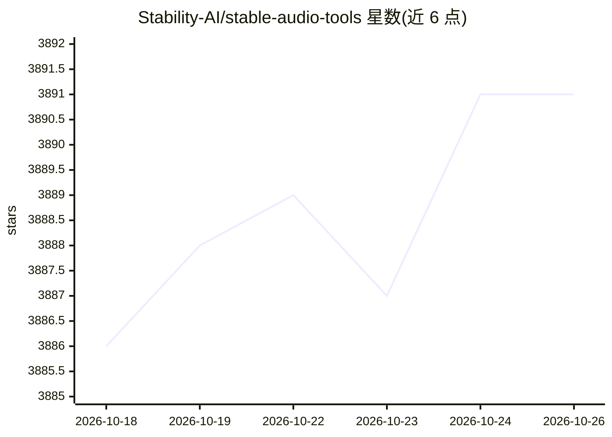

# Stability-AI/stable-audio-tools

⭐ 3,891 · Python · MIT · 推送 2026-10-24 · [GitHub](https://github.com/Stability-AI/stable-audio-tools) · 组织维护

**面向开发者的音频生成模型训练与推理代码库**

Stability AI 维护的条件音频生成模型训练与推理代码库，提供 train.py 训练脚本、run_gradio.py 推理演示界面、unwrap_model.py 检查点解包工具。基于 PyTorch Lightning 支持多 GPU/多节点训练（可启用 DeepSpeed ZeRO Stage 2），通过 JSON 配置文件定义模型与数据集，支持 autoencoder、条件/非条件扩散、扩散自编码器与语言模型等多种模型类型。训练需 Weights & Biases 账户记录输出；数据源支持本地音频目录与 S3 上的 WebDataset。要求 PyTorch 2.5+，开发环境为 Python 3.10。

## 筛选速览

| 维度 | 判定 | 备注 |
|---|---|---|
| AI 角色 | `ai-native` | 本体是模型或模型工具 |
| 许可风险 | `permissive` | MIT |
| 部署形态 | `library` | 以包/库形式分发 |
| 模型依赖 | — | README 未给出锁定关系 |
| 硬件要求 | — | 无带数字的原话,不猜 |
| 安装摩擦 | `low` | 无编译、无系统依赖或容器化 |
| 成熟度 | — | 结构信号不足 |

## 能力要点

- 支持 autoencoder/diffusion 系列与 lm 共 6 种模型类型的训练与推理
- PyTorch Lightning 多 GPU/多节点训练，DeepSpeed ZeRO Stage 2 可选
- 提供 Gradio 推理界面，可从 Hugging Face 加载 stable-audio-open-1.0 预训练模型
- 基于 JSON 的模型配置与数据集配置体系，支持微调与部分初始化

## 适用场景

- 从零训练或微调自己的音频生成模型
- 用 Gradio 界面测试预训练或自训的音频生成模型
- 把自训 autoencoder 用作潜在扩散模型的 pretransform

## 场景标签

`微调` `模型训练` · 领域:训练与推理

## 证据(README 行号)

> L2: Training and inference code for audio generation models
> L152:  - The type of model being defined, currently limited to one of `"autoencoder", "diffusion_uncond", "diffusion_con

## 星数曲线

2026-10-18 3,886 → 2026-10-26 3,891（+5）

---
*卡片 v1 · prompt 1.4 · 生成 2026-10-20 · 置信度 high · 依据 README sha `bd90b4e28d40` · [字段定义](../../DATASET.md)*
