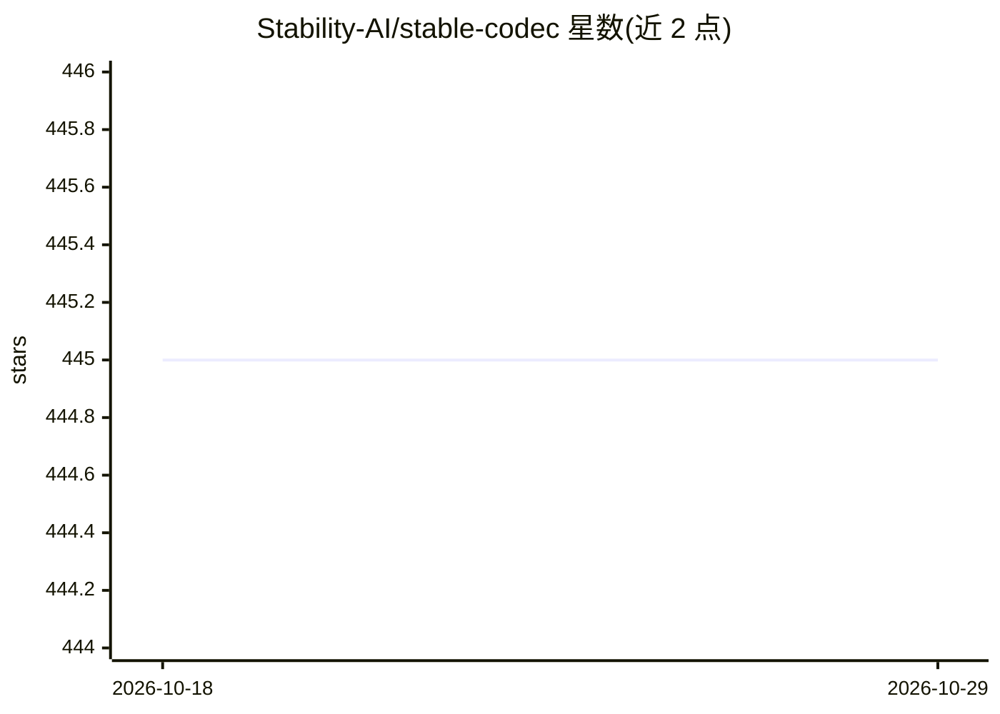

# Stability-AI/stable-codec

⭐ 445 · Python · MIT · 推送 2026-07-17 · [GitHub](https://github.com/Stability-AI/stable-codec) · [官网](https://stability-ai.github.io/stable-codec-demo/) · 组织维护

**低码率高音质语音编解码 Transformer 模型的训练与推理代码库**

Stability AI 的 Stable Codec 系列模型官方仓库，提供 stable-codec-speech-16k 及其 base 变体的训练与推理脚本。StableCodec 类封装了音频编码、token 解码与事后 FSQ bottleneck 配置（多种码率预设，400/700/1000 bps），支持从 HuggingFace 自动下载权重、执行微调（含 CTC loss 强化语义）与训练数据集配置。限制：硬性依赖 FlashAttention（滑窗注意力），当前不支持 CPU 推理；代码 MIT 许可但模型权重为 Stability AI Community License。

## 筛选速览

| 维度 | 判定 | 备注 |
|---|---|---|
| AI 角色 | `ai-native` | 本体是模型或模型工具 |
| 许可风险 | `permissive` | MIT |
| 部署形态 | `library` | 以包/库形式分发 |
| 模型依赖 | — | README 未给出锁定关系 |
| 硬件要求 | — | 无带数字的原话,不猜 |
| 安装摩擦 | `low` | 无编译、无系统依赖或容器化 |
| 成熟度 | — | 结构信号不足 |

## 能力要点

- Transformer 语音编解码器，低码率（400-1000 bps）压缩语音
- 事后 FSQ bottleneck 预设可调 token 字典大小与码率
- 提供微调脚本与 CTC loss 训练配置（强制对齐数据）
- 16k 主变体经 500k 步语义强化微调，适用于 TTS 等下游任务

## 适用场景

- 对语音做低码率编码并在需要时从 token 解码还原
- 为 TTS 等下游任务提供语义强化的离散语音 token
- 复现论文结果或基于官方权重继续微调

## 场景标签

`微调` · 领域:训练与推理

## 证据(README 行号)

> L3: This repository contains training and inference scripts for models in the Stable Codec series, starting with `stable
> L43: **IMPORTANT NOTE:** This model currently has a hard requirement for FlashAttention due to its use of sliding window

## 星数曲线

2026-10-18 445 → 2026-10-29 445（+0）

---
*卡片 v1 · prompt 1.4 · 生成 2026-10-21 · 置信度 high · 依据 README sha `94a92192d0e9` · [字段定义](../../DATASET.md)*
