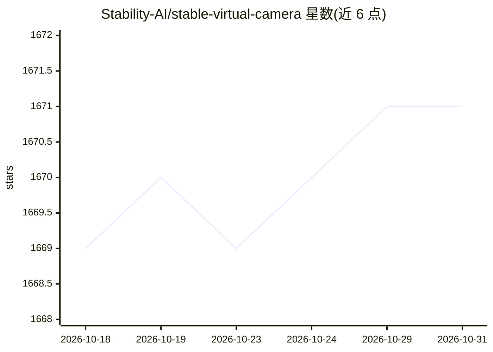

# Stability-AI/stable-virtual-camera

⭐ 1,671 · Python · NOASSERTION · 推送 2026-03-03 · [GitHub](https://github.com/Stability-AI/stable-virtual-camera) · [官网](https://stable-virtual-camera.github.io) · 组织维护

**扩散模型新视角合成：输入任意视角图像生成 3D 一致新视角**

Stability AI 与牛津、UC Berkeley 合作发布的通用扩散模型 Stable Virtual Camera (SEVA)，从任意数量的输入视角与目标相机参数生成场景的 3D 一致新视角视频。模型 1.3B 参数、576P 分辨率，权重托管于 Hugging Face（需认证访问），输出遵循非商业许可。提供 Gradio 图形界面与 CLI 两种演示入口，后者支持细粒度控制与 NVS 模型基准评测；训练脚本未正式包含，仅社区 PR。

## 筛选速览

| 维度 | 判定 | 备注 |
|---|---|---|
| AI 角色 | `ai-native` | 本体是模型或模型工具 |
| 许可风险 | `none` | NOASSERTION |
| 部署形态 | `library` | 以包/库形式分发 |
| 模型依赖 | — | README 未给出锁定关系 |
| 硬件要求 | — | 无带数字的原话,不猜 |
| 安装摩擦 | `low` | 无编译、无系统依赖或容器化 |
| 成熟度 | — | 结构信号不足 |

## 能力要点

- 给定任意数量输入视角与目标相机，生成 3D 一致的 novel views
- 提供 1.1/1.0 两版 1.3B 模型检查点（576P）
- Gradio 图形界面与细粒度 CLI 两种使用方式，附 NVS 基准评测工具

## 适用场景

- 从多张照片生成场景新视角的视频
- 研究者对新视角合成模型做基准评测
- 非商业用途的 3D 内容生成实验

## 场景标签

`视频生成` `模型评测` · 领域:评测与运维

## 证据(README 行号)

> L17: `Stable Virtual Camera (SEVA)` is a generalist diffusion model for Novel View Synthesis (NVS), generating 3D consis
> L57: We provide two demos for you to interact with `Stable Virtual Camera`.

## 星数曲线

2026-10-18 1,669 → 2026-10-31 1,671（+2）

---
*卡片 v1 · prompt 1.4 · 生成 2026-10-21 · 置信度 high · 依据 README sha `48e80fc8ecfd` · [字段定义](../../DATASET.md)*
