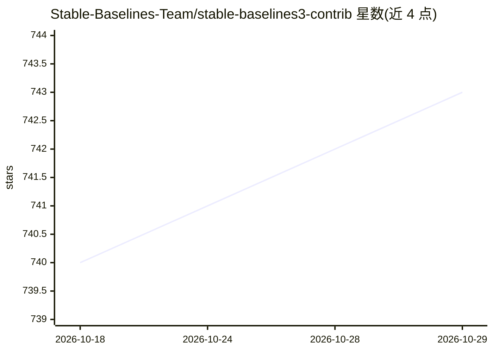

# Stable-Baselines-Team/stable-baselines3-contrib

⭐ 743 · Python · MIT · 推送 2026-10-26 · [GitHub](https://github.com/Stable-Baselines-Team/stable-baselines3-contrib) · [官网](https://sb3-contrib.readthedocs.io) · 组织维护

**Stable-Baselines3 的实验性强化学习算法扩展包**

sb3-contrib 是 stable-baselines3 的 contrib 包，收录被认为实验性的 RL 算法与工具，如 ARS、QR-DQN、MaskablePPO、RecurrentPPO、TQC、TRPO、CrossQ 等，以及 Gym 的 Time Feature Wrapper。目标是保持 stable-baselines3 的简洁性、文档与代码风格，但容纳成熟度较低或较小众的实现，不要求与主库深度集成。通过 pip 安装，面向使用 PyTorch 与 Gym 的强化学习研究者与开发者。

## 筛选速览

| 维度 | 判定 | 备注 |
|---|---|---|
| AI 角色 | `ai-native` | 本体是模型或模型工具 |
| 许可风险 | `permissive` | MIT |
| 部署形态 | `library` | 以包/库形式分发 |
| 模型依赖 | — | README 未给出锁定关系 |
| 硬件要求 | — | 无带数字的原话,不猜 |
| 安装摩擦 | `low` | 无编译、无系统依赖或容器化 |
| 成熟度 | `idea` | |

## 能力要点

- 提供 ARS、QR-DQN、MaskablePPO、RecurrentPPO、TQC、TRPO、CrossQ 等实验性 RL 算法实现
- 包含 Time Feature 等 Gym 环境包装器
- 保持 stable-baselines3 的代码风格与文档标准
- 支持 pip 安装 master 版本（git 源码）

## 适用场景

- 在 SB3 生态中使用最新论文的实验性 RL 算法
- 训练带无效动作掩码或循环策略的 PPO
- 为 Gym 环境添加时间特征等包装器

## 场景标签

`强化学习` · 领域:训练与推理

## 证据(README 行号)

> L5: Contrib package for Stable-Baselines3 - Experimental reinforcement learning (RL) code.
> L23: **RL Algorithms**:
> L24: - Augmented Random Search (ARS)

## 星数曲线

2026-10-18 740 → 2026-10-29 743（+3）

---
*卡片 v1 · prompt 1.4 · 生成 2026-10-21 · 置信度 high · 依据 README sha `65658a052db2` · [字段定义](../../DATASET.md)*
