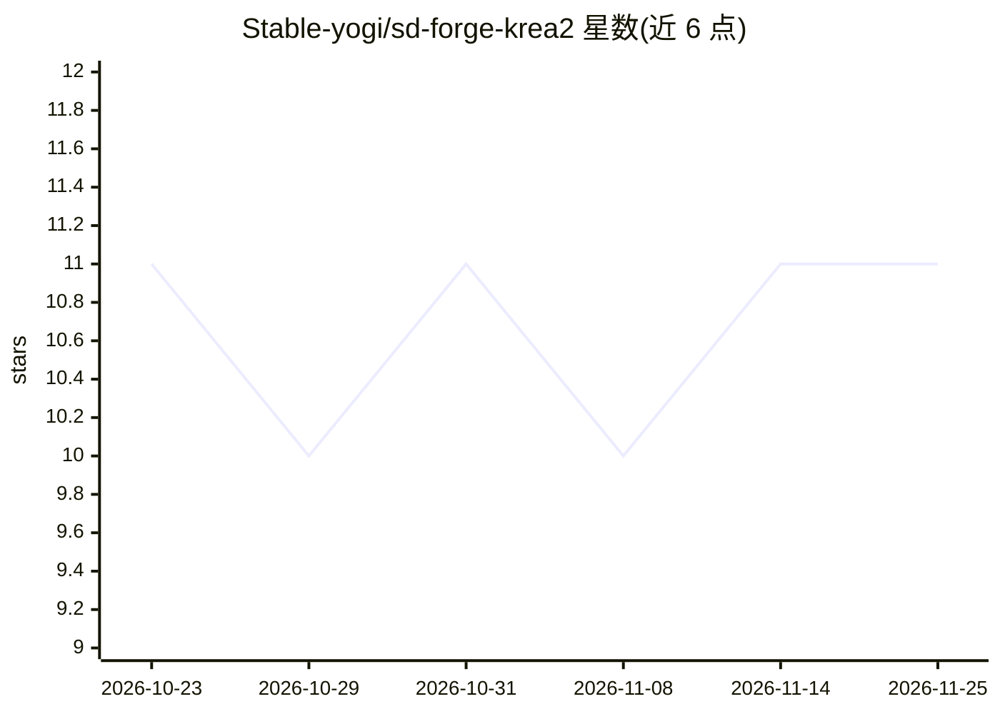

# Stable-yogi/sd-forge-krea2

⭐ 11 · Python · GPL-3.0 · 推送 2026-08-18 · [GitHub](https://github.com/Stable-yogi/sd-forge-krea2) · 个人维护

**在 Forge Neo 中本地运行 Krea 2 文生图模型的扩展**

面向 Stable Diffusion WebUI Forge (Neo) 的 Krea 2 架构集成扩展：注册 12B 单流 DiT 文生图模型（Qwen3-VL 文本编码器 + Qwen-Image VAE），提供一键模型下载、krea2 UI 预设、fp8 量化加载、整包与分件两种加载方式，以及可选的 Detail Boost 条件重平衡功能。依赖 Forge Neo（neo 分支），无额外 Python 依赖；fp8 需约 16–20 GB 显存，bf16 需 24 GB+。扩展本身为 GPL-3.0，模型权重另行适用 Krea 2 Community License。

## 筛选速览

| 维度 | 判定 | 备注 |
|---|---|---|
| AI 角色 | `ai-native` | 本体是模型或模型工具 |
| 许可风险 | `viral` | GPL-3.0 |
| 部署形态 | `None` |  |
| 模型依赖 | — | README 未给出锁定关系 |
| 硬件要求 | `gpu-8g` | |
| 安装摩擦 | `low` | 无编译、无系统依赖或容器化 |
| 成熟度 | — | 结构信号不足 |

## 能力要点

- 一键模型下载器，文件自动落入 Forge 标准目录
- 支持整包 checkpoint 与 DiT+TE/VAE 分件两种加载方式
- fp8 量化降低体积与显存占用，另有 GGUF 低显存构建
- krea2 预设自动配置采样器、步数、CFG 与 TE/VAE

## 适用场景

- 在 Forge 中原生生成 Krea 2 图像而无需 ComfyUI
- 低显存环境下用 fp8/GGUF 构建运行 12B 模型
- 自动下载并放置模型文件，免去手动命令行操作

## 场景标签

`图像生成` · 领域:内容生成

## 证据(README 行号)

> L3: Run **Krea 2** (Krea AI's 12B single-stream DiT) in **Stable Diffusion WebUI Forge (Neo)**.
> L20: - Native Krea 2 architecture in Forge — no ComfyUI needed.
> L38: - An NVIDIA GPU with enough VRAM (fp8 set ≈ 16–20 GB; bf16 set ≈ 24 GB+).

## 星数曲线

2026-10-23 11 → 2026-11-25 11（+0）

---
*卡片 v1 · prompt 1.4 · 生成 2026-11-19 · 置信度 high · 依据 README sha `68b0041632a8` · [字段定义](../../DATASET.md)*
