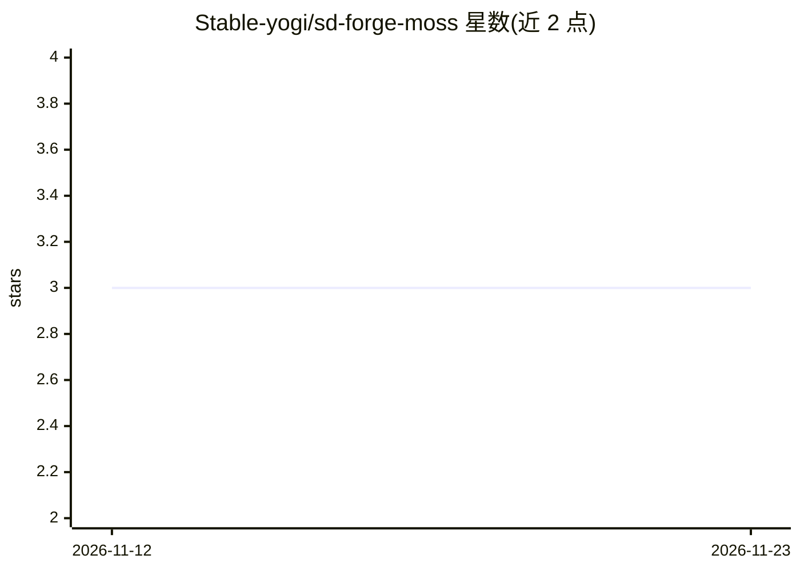

# Stable-yogi/sd-forge-moss

⭐ 3 · Python · GPL-3.0 · 推送 2026-11-07 · [GitHub](https://github.com/Stable-yogi/sd-forge-moss) · 个人维护

**在 Forge Neo 中运行 MOSS-Image 文生图的扩展**

为 Forge Neo 添加 MOSS-Image（OpenMOSS）文生图支持的扩展，运行在 Forge 内部，复用原有检查点列表、Generate 按钮与采样器。需从 ComfyUI 包下载模型、文本编码器与 VAE 文件放入对应目录；扩展可自动按文件名查找文本编码器和 VAE，并内置 moss 预设（Euler/Simple/25 步/CFG 2.5）。仅支持文生图，shift 固定为 5.0。在 RTX 5090（32GB）上测试于 Forge Neo neo-2.30.1。

## 筛选速览

| 维度 | 判定 | 备注 |
|---|---|---|
| AI 角色 | `ai-native` | 本体是模型或模型工具 |
| 许可风险 | `viral` | GPL-3.0 |
| 部署形态 | `None` |  |
| 模型依赖 | — | README 未给出锁定关系 |
| 硬件要求 | — | 无带数字的原话,不猜 |
| 安装摩擦 | `low` | 无编译、无系统依赖或容器化 |
| 成熟度 | — | 结构信号不足 |

## 能力要点

- 自动按文件名查找 Qwen3.5 文本编码器与 FLUX.2 VAE
- 内置 moss 预设设定采样器与参数
- 可选 Spectrum 加速：跳过约一半模型运行，采样约 2 倍快
- 提供 CPU 上生成 mixed INT4 文件的工具脚本

## 适用场景

- 在 Forge Neo 中用 MOSS-Image 生成 1024x1024 文生图
- 使用 INT4/mixed INT4 文件在显存受限时加载模型
- 旧版 Forge Neo 需要手动接入 MOSS-Image 支持

## 场景标签

`图像生成` · 领域:内容生成

## 证据(README 行号)

> L3: Adds text-to-image support for **MOSS-Image** (OpenMOSS) to
> L23: 1. Copy this folder into `extensions/` (or *Extensions > Install from URL*). Restart Forge fully.

## 星数曲线

2026-11-12 3 → 2026-11-23 3（+0）

---
*卡片 v1 · prompt 1.4 · 生成 2026-11-22 · 置信度 high · 依据 README sha `fb3652d0b287` · [字段定义](../../DATASET.md)*
