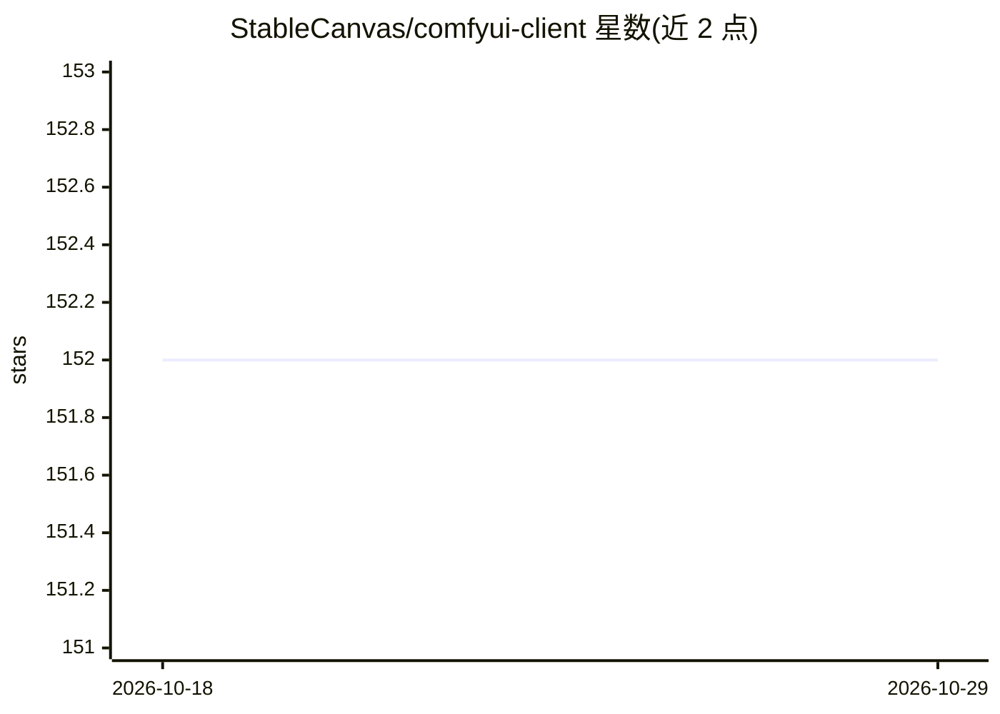

# StableCanvas/comfyui-client

⭐ 152 · TypeScript · MIT · 推送 2026-10-25 · [GitHub](https://github.com/StableCanvas/comfyui-client) · [官网](https://stablecanvas.github.io/comfyui-client/) · 个人维护

**ComfyUI 的 JS API 客户端，覆盖全部 REST/WebSocket 接口**

面向开发者的 ComfyUI JavaScript/TypeScript 客户端库，同时支持 NodeJS 与浏览器环境，覆盖 ComfyUI 全部 RESTful 与 WebSocket API，内置 TypeScript 类型。提供可编程 workflow 接口，以人类可读格式创建和管理 ComfyUI 工作流；monorepo 结构下含核心客户端、将工作流转为 JS 代码的 CLI、从图片/JSON 读取工作流信息的 cw-reader 及底层 transpiler 四个 npm 包。库本身零外部依赖。

## 筛选速览

| 维度 | 判定 | 备注 |
|---|---|---|
| AI 角色 | `ai-ecosystem` | LLM/agent 周边工具 |
| 许可风险 | `permissive` | MIT |
| 部署形态 | `None` |  |
| 模型依赖 | — | README 未给出锁定关系 |
| 硬件要求 | — | 无带数字的原话,不猜 |
| 安装摩擦 | `low` | 无编译、无系统依赖或容器化 |
| 成熟度 | — | 结构信号不足 |

## 能力要点

- 覆盖 ComfyUI 全部 RESTful 与 WebSocket API
- 同时支持 NodeJS 与浏览器环境，内置 TypeScript 类型
- 可编程 workflow 接口与工作流转代码的 CLI/transpiler
- 库自身零外部依赖

## 适用场景

- 在 NodeJS 或 Web 应用中接入 ComfyUI 生成图片
- 把 ComfyUI 工作流转成 JS 代码用于脚本与自动化
- 从生成图片或 JSON 中读取工作流信息

## 场景标签

`图像生成` · 领域:内容生成

## 证据(README 行号)

> L7: Javascript api Client for ComfyUI that supports both NodeJS and Browser environments.
> L9: This client provides comprehensive support for all available RESTful and WebSocket APIs, with built-in TypeScript ty
> L40: - **Comprehensive API Support**: Provides full support for all available RESTful and WebSocket APIs.

## 星数曲线

2026-10-18 152 → 2026-10-29 152（+0）

---
*卡片 v1 · prompt 1.4 · 生成 2026-10-22 · 置信度 high · 依据 README sha `dccbf3d918cb` · [字段定义](../../DATASET.md)*
