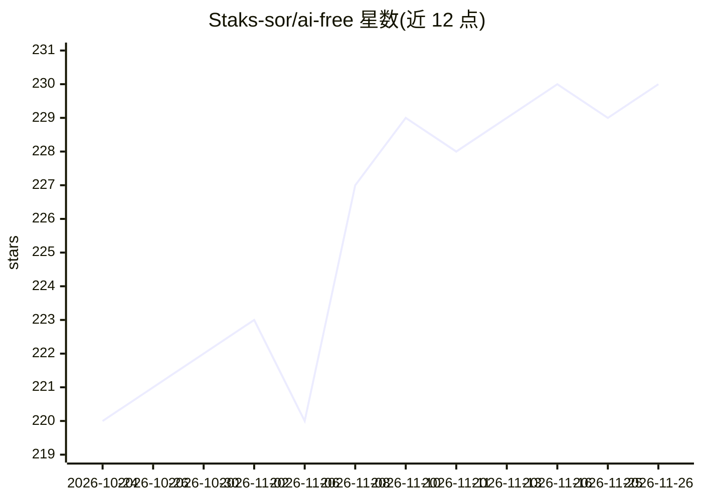

# Staks-sor/ai-free

⭐ 230 · JavaScript · NOASSERTION · 推送 2026-11-25 · [GitHub](https://github.com/Staks-sor/ai-free) · [官网](https://github.com/Staks-sor/ai-free#readme) · 个人维护

**把 DeepSeek/Qwen/ChatGPT 网页聊天接入本地开发流程的客户端**

本地运行的 AI 客户端：将 DeepSeek、Qwen、ChatGPT、Google AI Mode、GLM 等网页聊天聚合到一个窗口（localhost:4317），并提供终端 REPL、OpenAI/Anthropic 兼容 API（localhost:4318）供 Kilo Code、Continue 等 IDE 工具接入。内置 /code 开发代理（读写 workspace 文件、执行许可命令）、SQLite FTS5 + Markdown 的持久记忆与记忆图谱、可自动匹配的 skills 机制及 AGENTS.md 项目规则加载。需要 Node.js 22+，通过 git clone + npm install 安装；登录依赖浏览器会话恢复，部分提供商登录需 Python 3.10+。

## 筛选速览

| 维度 | 判定 | 备注 |
|---|---|---|
| AI 角色 | `ai-ecosystem` | LLM/agent 周边工具 |
| 许可风险 | `none` | NOASSERTION |
| 部署形态 | `desktop` | 安装包/桌面程序 |
| 模型依赖 | locked-api |  |
| 硬件要求 | — | 无带数字的原话,不猜 |
| 安装摩擦 | `low` | 无编译、无系统依赖或容器化 |
| 成熟度 | — | 结构信号不足 |

## 能力要点

- 聚合四个以上提供商网页聊天，按项目文件夹组织多会话
- 提供 OpenAI/Anthropic 兼容 API 供 IDE 插件接入
- SQLite FTS5 + Markdown vault 的长期记忆与 task-file-bug-fix 记忆图谱
- AGENTS.md 分层规则加载与 skills 自动匹配（code-review/bug-fix/video-script）

## 适用场景

- 在本地终端和 IDE 里使用已有的 DeepSeek/Qwen/ChatGPT 网页账号做开发
- 给 Kilo Code、Continue 等 IDE 工具接一个本地兼容 API
- 让代理跨会话记住项目的任务、文件与修复历史

## 场景标签

`模型网关` `编码 Agent` · 领域:Agent 开发

## 证据(README 行号)

> L51: > Локальный AI-клиент, который превращает веб-чаты DeepSeek, Qwen, ChatGPT и Google AI Mode в инструмент для разраб
> L74: - 🔌 **Совместимые API** (`localhost:4318`): OpenAI и Anthropic для Kilo Code, Continue и других IDE.

## 星数曲线

2026-10-24 220 → 2026-11-26 230（+10）

---
*卡片 v1 · prompt 1.4 · 生成 2026-11-26 · 置信度 mid · 依据 README sha `506a7b90145c` · [字段定义](../../DATASET.md)*
