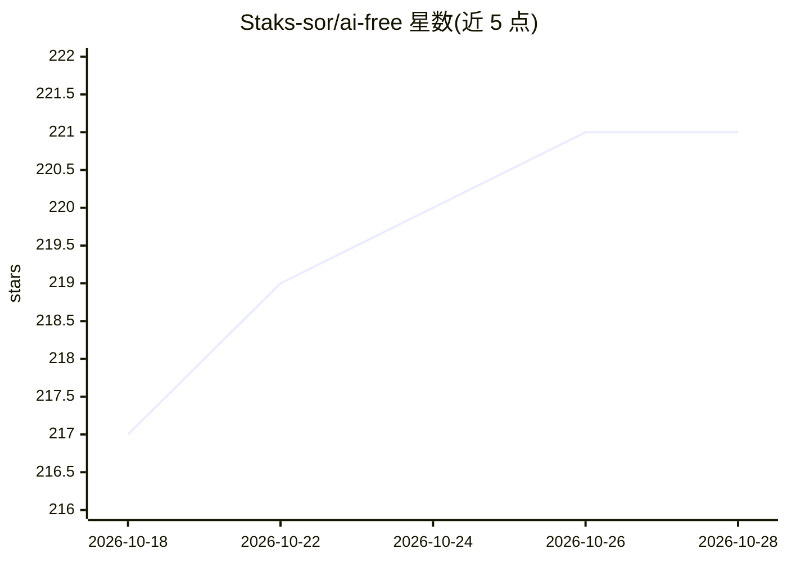

# Staks-sor/ai-free

⭐ 221 · JavaScript · NOASSERTION · 推送 2026-08-20 · [GitHub](https://github.com/Staks-sor/ai-free) · [官网](https://github.com/Staks-sor/ai-free#readme) · 个人维护

**把 DeepSeek/Qwen/ChatGPT 网页聊天变为本地 AI 客户端与代码代理**

开源的本地 AI 客户端与开发者工具：通过浏览器会话登录 DeepSeek、Qwen 与 ChatGPT 的免费网页聊天，将其接入桌面窗口、CLI REPL、本地 OpenAI 兼容 API 与 Anthropic 兼容 API，并提供 VS Code 插件。内置 `/code` 代码代理（workspace 文件访问与受控命令权限）、SQLite FTS5 + Markdown 的长期记忆、memory graph、skills 与层级化 AGENTS.md 项目指令。安装需 Node.js ≥ 18 与 Chromium（约 150 MB，npm install 自动下载），Linux 需额外安装 Chromium 系统依赖。

## 筛选速览

| 维度 | 判定 | 备注 |
|---|---|---|
| AI 角色 | `ai-native` | 本体是模型或模型工具 |
| 许可风险 | `none` | NOASSERTION |
| 部署形态 | `desktop` | 安装包/桌面程序 |
| 模型依赖 | locked-api |  |
| 硬件要求 | — | 无带数字的原话,不猜 |
| 安装摩擦 | `low` | 无编译、无系统依赖或容器化 |
| 成熟度 | — | 结构信号不足 |

## 能力要点

- DeepSeek/Qwen/ChatGPT 统一接入桌面、CLI 与 OpenAI/Anthropic 兼容 API
- `/code` 代理可读写 workspace 文件并执行受控命令
- SQLite FTS5 + Markdown vault 的长期记忆与 memory graph
- 层级化 AGENTS.md 在每次代理任务前重载，内置 code-review/bug-fix 等 skills

## 适用场景

- 在一个本地窗口里使用 DeepSeek、Qwen 和 ChatGPT 编码助手
- 把免费网页聊天封装成 OpenAI 兼容 API 供 Continue/Kilo Code 等 IDE 工具调用
- 带本地记忆和 skills 的重复性开发任务工作流

## 场景标签

`Agent 记忆` `模型网关` `编码 Agent` · 领域:Agent 开发

## 证据(README 行号)

> L17: **AI Free** is an open-source local AI client and developer tool for using free web AI chats as a practical coding 
> L23: - Run Qwen, DeepSeek and ChatGPT from one local desktop app.

## 星数曲线

2026-10-18 217 → 2026-10-28 221（+4）

---
*卡片 v1 · prompt 1.4 · 生成 2026-10-22 · 置信度 high · 依据 README sha `5a2956c9c94e` · [字段定义](../../DATASET.md)*
