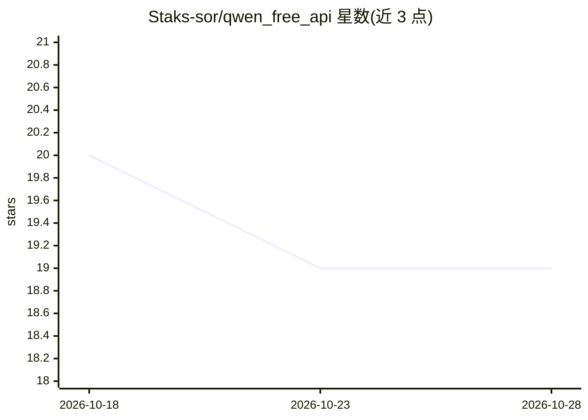

# Staks-sor/qwen_free_api

⭐ 20 · Python · 推送 2026-07-19 · [GitHub](https://github.com/Staks-sor/qwen_free_api) · 个人维护

**通过代理访问 Qwen API 的 Python 客户端与终端聊天工具**

Python 模块，通过代理 aikit.club 以 OpenAI 兼容方式访问 Qwen API，处理 WAF 绕过与令牌自动填充。包含 QwenClient 客户端类（可导入自有项目）、带动画输出的交互式终端聊天 chat.py、config.py 配置（URL、超时 120 秒）与 credentials.json 令牌模板。令牌文件通过 .gitignore 排除。模型名留空由服务端自动选择。安装方式为 pip 安装 requirements.txt 依赖。

## 筛选速览

| 维度 | 判定 | 备注 |
|---|---|---|
| AI 角色 | `ai-native` | 本体是模型或模型工具 |
| 许可风险 | `none` | — |
| 部署形态 | `library` | 以包/库形式分发 |
| 模型依赖 | — | README 未给出锁定关系 |
| 硬件要求 | — | 无带数字的原话,不猜 |
| 安装摩擦 | `low` | 无编译、无系统依赖或容器化 |
| 成熟度 | — | 结构信号不足 |

## 能力要点

- QwenClient 客户端类可导入任意 Python 项目
- 终端交互式聊天（带动画与格式化输出）
- 自动绕过 WAF 并自动填充令牌
- OpenAI 兼容的代理端点配置

## 适用场景

- 在终端中直接与 Qwen 对话
- 在自有 Python 项目中调用 Qwen 生成内容

## 场景标签

`聊天机器人` · 领域:对话与助手

## 证据(README 行号)

> L8: * `chat.py` — Интерактивный чат в терминале (с анимацией и красивым выводом).
> L9: * `qwen_client.py` — Основной класс клиента (`QwenClient`).

## 星数曲线

2026-10-18 20 → 2026-10-28 19（-1）

---
*卡片 v1 · prompt 1.4 · 生成 2026-10-28 · 置信度 mid · 依据 README sha `3637a18c1e2c` · [字段定义](../../DATASET.md)*
