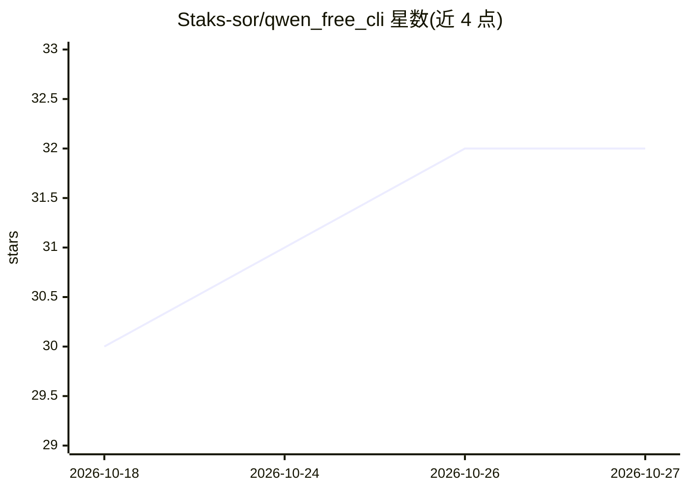

# Staks-sor/qwen_free_cli

⭐ 32 · Python · 推送 2026-07-20 · [GitHub](https://github.com/Staks-sor/qwen_free_cli) · 个人维护

**在项目内运行 Qwen Code CLI 编码代理的启动模板**

最小化模板项目：将 qwen_free_cli 文件夹克隆进任意项目，通过 shell 脚本以 --auth-type openai 方式启动 Qwen Code CLI 终端编码代理，access_token 从 credentials.json 读取，连接 OpenAI-compatible 端点（qwen.aikit.club/v1，模型 qwen3.6-plus），读写父项目文件。附带最小 Python API 客户端与 chat.py 验证脚本，可在 PyCharm/VS Code 内置终端或普通终端运行，支持交互与 one-shot 两种模式（one-shot 下部分端点可能将 tool-call 以纯文本返回）。

## 筛选速览

| 维度 | 判定 | 备注 |
|---|---|---|
| AI 角色 | `ai-ecosystem` | LLM/agent 周边工具 |
| 许可风险 | `none` | — |
| 部署形态 | `library` | 以包/库形式分发 |
| 模型依赖 | — | README 未给出锁定关系 |
| 硬件要求 | — | 无带数字的原话,不猜 |
| 安装摩擦 | `low` | 无编译、无系统依赖或容器化 |
| 成熟度 | — | 结构信号不足 |

## 能力要点

- 以 --auth-type openai 绕过 IDE OAuth，从项目内 credentials.json 读取 token
- 连接 OpenAI-compatible 端点并使用 qwen3.6-plus 模型
- 提供交互与 one-shot 两种运行模式
- 附 chat.py 用于验证 token 与端点连通性

## 适用场景

- 在自有项目中以 CLI 方式使用编码代理生成和修改文件
- 在 PyCharm/VS Code 内置终端运行 Qwen Code 而不依赖 IDE 扩展
- 用提供的 Python 脚本快速验证 API token 与端点

## 场景标签

`编码 Agent` · 领域:编码与开发

## 证据(README 行号)

> L3: Минимальный шаблон для запуска `Qwen Code CLI` как coding agent через OpenAI-compatible API.
> L31: `Qwen Code CLI` - это не сама модель. Это терминальный агент для программирования.
> L39:   -> подключается к https://qwen.aikit.club/v1

## 星数曲线

2026-10-18 30 → 2026-10-27 32（+2）

---
*卡片 v1 · prompt 1.4 · 生成 2026-10-26 · 置信度 mid · 依据 README sha `d01f6b6b69c0` · [字段定义](../../DATASET.md)*
