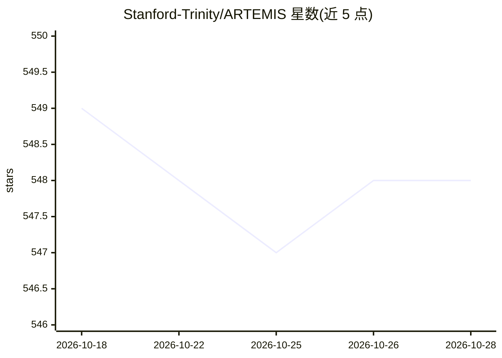

# Stanford-Trinity/ARTEMIS

⭐ 548 · Rust · Apache-2.0 · 推送 2026-04-14 · [GitHub](https://github.com/Stanford-Trinity/ARTEMIS) · 组织维护

**自动化漏洞发现的多智能体红队引擎**

Stanford Trinity 项目的自主红队代理：由监督者（supervisor）调度派生的 Codex 实例子代理，自动执行漏洞发现任务，支持以 CTF 挑战做基准测试运行。LLM 调用通过 OpenRouter 或 OpenAI API 接入，子代理模型可配置。安装需先用 Rust 工具链编译 codex 二进制，再用 uv 配置 Python 环境，另提供 Docker 构建与运行脚本。README 未展开说明具体漏洞发现机制与适用目标范围。

## 筛选速览

| 维度 | 判定 | 备注 |
|---|---|---|
| AI 角色 | `ai-native` | 本体是模型或模型工具 |
| 许可风险 | `permissive` | Apache-2.0 |
| 部署形态 | `self-host` | docker 或自建部署 |
| 模型依赖 | locked-api |  |
| 硬件要求 | — | 无带数字的原话,不猜 |
| 安装摩擦 | `low` | 无编译、无系统依赖或容器化 |
| 成熟度 | — | 结构信号不足 |

## 能力要点

- 监督者多智能体架构，派生 Codex 实例执行任务
- 支持 OpenRouter / OpenAI 双接入方式
- 内置 CTF 挑战的基准测试模式（--benchmark-mode）
- 提供 Docker 构建与 run_docker.sh 运行脚本

## 适用场景

- 自动化执行 CTF 挑战验证红队流程
- 安全研究中批量探测漏洞
- 以基准模式评估代理在安全任务上的表现

## 场景标签

`多智能体` `网络安全` · 领域:Agent 开发

## 证据(README 行号)

> L3:  ARTEMIS is an autonomous agent created by the Stanford Trinity project to automate vulnerability discovery.
> L45: - `OPENROUTER_API_KEY` or `OPENAI_API_KEY` - For the supervisor and LLM calls

## 星数曲线

2026-10-18 549 → 2026-10-28 548（-1）

---
*卡片 v1 · prompt 1.4 · 生成 2026-10-21 · 置信度 high · 依据 README sha `6fe1e02f83de` · [字段定义](../../DATASET.md)*
