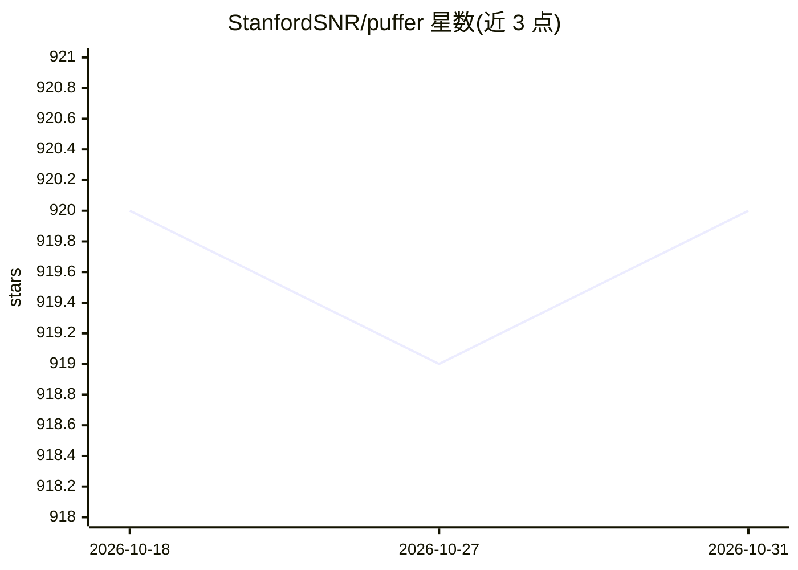

# StanfordSNR/puffer

⭐ 920 · C++ · 推送 2025-11-07 · [GitHub](https://github.com/StanfordSNR/puffer) · [官网](https://puffer.stanford.edu) · 组织维护

**斯坦福研究项目：免费直播电视流媒体网站，用 ML 改进视频流**

斯坦福大学 StanfordSNR 团队的免费开源直播电视流媒体网站，同时是一项使用机器学习改进视频流传输的研究。项目提供网站（puffer.stanford.edu）、研究论文（获 NSDI 2020 Community Award）与文档。README 未给出安装、运行或模型细节，具体部署方式需查阅文档。面向视频流媒体与在线学习方向的研究人员及使用者。

## 筛选速览

| 维度 | 判定 | 备注 |
|---|---|---|
| AI 角色 | `ai-native` | 本体是模型或模型工具 |
| 许可风险 | `none` | — |
| 部署形态 | `None` |  |
| 模型依赖 | — | README 未给出锁定关系 |
| 硬件要求 | — | 无带数字的原话,不猜 |
| 安装摩擦 | `low` | 无编译、无系统依赖或容器化 |
| 成熟度 | — | 结构信号不足 |

## 能力要点

- 免费开源的直播电视流媒体网站
- 以机器学习改进视频流传输的研究项目
- 相关论文获 NSDI 2020 Community Award

## 适用场景

- 观看免费直播电视流媒体
- 研究机器学习在自适应视频流中的应用
- 查阅视频流传输研究论文与文档

## 场景标签

 · 领域:视频流媒体/网络研究

## 证据(README 行号)

> L3: Puffer (puffer.stanford.edu) is a free and open-source live TV streaming website,
> L4: and also a research study at Stanford University using machine learning to
> L5: improve video streaming.

## 星数曲线

2026-10-18 920 → 2026-10-31 920（+0）

---
*卡片 v1 · prompt 1.4 · 生成 2026-10-21 · 置信度 mid · 依据 README sha `5b8b8e28ef6f` · [字段定义](../../DATASET.md)*
