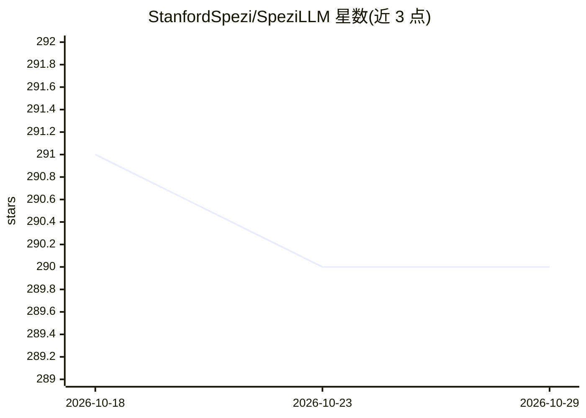

# StanfordSpezi/SpeziLLM

⭐ 290 · Swift · MIT · 推送 2026-09-27 · [GitHub](https://github.com/StanfordSpezi/SpeziLLM) · [官网](https://swiftpackageindex.com/StanfordSpezi/SpeziLLM/documentation) · 组织维护

**Swift 包：为 Spezi 应用集成 LLM（本地/OpenAI/局域网 Fog 节点）**

面向 Spezi 生态（Swift/SwiftUI 健康应用框架）的 LLM Swift 包，含多个 target：SpeziLLMLocal 基于 mlx-swift 在 Apple 设备本地运行 Hugging Face 开源模型（Llama2、Phi、Gemma、DeepSeek-R1 等）；SpeziLLMOpenAI 通过 OpenAI API 使用 GPT 模型并提供函数调用 DSL；SpeziLLMFog 通过 mDNS/Bonjour 发现局域网 Fog 节点并派发推理任务（提供 Docker 版 FogNode 包）；另有本地模型下载管理模块。本地执行不兼容模拟器（需 Metal GPU），部分模型需 Increase Memory Limit entitlement。

## 筛选速览

| 维度 | 判定 | 备注 |
|---|---|---|
| AI 角色 | `ai-ecosystem` | LLM/agent 周边工具 |
| 许可风险 | `permissive` | MIT |
| 部署形态 | `None` |  |
| 模型依赖 | — | README 未给出锁定关系 |
| 硬件要求 | — | 无带数字的原话,不猜 |
| 安装摩擦 | `low` | 无编译、无系统依赖或容器化 |
| 成熟度 | — | 结构信号不足 |

## 能力要点

- 本地设备端 LLM 执行（mlx-swift），支持 Hugging Face 开源模型
- OpenAI GPT API 集成与函数调用声明式 DSL
- Fog 节点推理派发：mDNS 发现局域网节点、流式返回、Bearer 授权
- 内置 SwiftUI 聊天视图与模型下载 onboarding 视图

## 适用场景

- 在 iOS 应用中本地运行开源 LLM 做对话或推理
- 在 Spezi 应用里接入 OpenAI GPT 并使用函数调用
- 把推理负载卸载到局域网内 Fog 计算节点

## 场景标签

`模型网关` · 领域:Agent 开发

## 证据(README 行号)

> L9: The Spezi LLM Swift Package includes modules that are helpful to integrate LLM-related functionality in your applica
> L33: Spezi LLM provides a number of targets to help developers integrate LLMs in their Spezi-based applications:
> L34: - SpeziLLM: Base infrastructure of LLM execution in the Spezi ecosystem.

## 星数曲线

2026-10-18 291 → 2026-10-29 290（-1）

---
*卡片 v1 · prompt 1.4 · 生成 2026-10-22 · 置信度 high · 依据 README sha `b8adc4209af9` · [字段定义](../../DATASET.md)*
