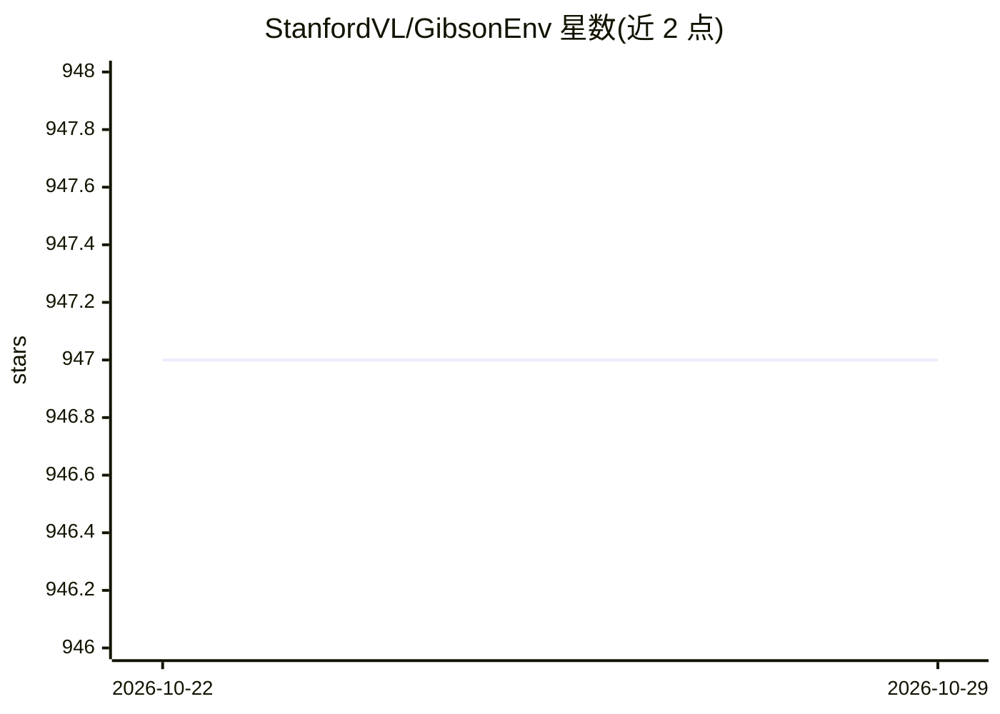

# StanfordVL/GibsonEnv

⭐ 947 · C · MIT · 推送 2026-10-20 · [GitHub](https://github.com/StanfordVL/GibsonEnv) · [官网](http://gibsonenv.stanford.edu/) · 组织维护

**供具身智能体在真实感场景中训练感知的仿真环境**

StanfordVL 发布的具身智能体仿真环境（CVPR 2018），将真实空间虚拟化为 572 个空间、1440 层数据库，集成 Bulletphysics 物理引擎使智能体受空间与物理约束，并内置向真实世界迁移的 Goggles 机制。提供 Mujoco Ant/Humanoid、Husky 等智能体及力矩/速度/位置控制器，支持 RGBD、深度、法线、语义分割等观测输出与逐像素语义掩码。通过 Docker 镜像或源码编译安装，需 Ubuntu + NVIDIA GPU（VRAM>6GB）+ CUDA，提供 PPO 训练示例与 Web UI。

## 筛选速览

| 维度 | 判定 | 备注 |
|---|---|---|
| AI 角色 | `ai-ecosystem` | LLM/agent 周边工具 |
| 许可风险 | `permissive` | MIT |
| 部署形态 | `self-host` | docker 或自建部署 |
| 模型依赖 | — | README 未给出锁定关系 |
| 硬件要求 | `gpu-8g` | |
| 安装摩擦 | `low` | 无编译、无系统依赖或容器化 |
| 成熟度 | — | 结构信号不足 |

## 能力要点

- 虚拟化 572 个真实空间、1440 层的数据库（核心包含 39 个子集）
- 集成 Bulletphysics 物理引擎，智能体受空间与物理约束
- Goggles 机制用于 sim2real 迁移
- 支持 RGBD/深度/法线/语义分割观测与逐像素语义掩码

## 适用场景

- 用视觉输入做强化学习导航训练（PPO1/PPO2 示例）
- 在真实感室内场景中评测具身智能体的感知能力
- 接入 Stanford 2D3DS / Matterport 3D 数据集做语义感知研究

## 场景标签

`模型评测` `强化学习` · 领域:评测与运维

## 证据(README 行号)

> L3: You shouldn't play video games all day, so shouldn't your AI! We built a virtual environment simulator, Gibson, that
> L9: **III.** embodiment of the agent and making it subject to constraints of space and physics via integrating a physics
> L159: python examples/train/train_husky_navigate_ppo2.py ### Use PPO2 to train a car to navigate down the hallway in Gat

## 星数曲线

2026-10-22 947 → 2026-10-29 947（+0）

---
*卡片 v1 · prompt 1.4 · 生成 2026-10-21 · 置信度 mid · 依据 README sha `7a8a5bfba448` · [字段定义](../../DATASET.md)*
