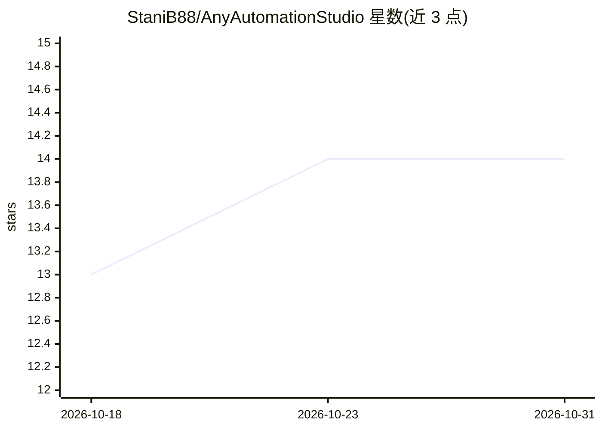

# StaniB88/AnyAutomationStudio

⭐ 14 · 推送 2026-10-25 · [GitHub](https://github.com/StaniB88/AnyAutomationStudio) · [官网](https://anyautomation.ch/studio) · 组织维护

**面向西门子 TIA Portal/CODESYS 的 PLC 工程 AI IDE**

Windows 桌面 IDE，面向 PLC 工程师。通过官方 Openness API 连接西门子 TIA Portal（V15–V21）与 CODESYS 3.5，在一个工作区中提供：多提供商 AI 助手（Claude/GPT/Gemini、20+ 云提供商或 Ollama/LM Studio/vLLM/SGLang 本地模型）生成/重构/解释 SCL，并行 AI Agent 会话；基于 PLCSIM Advanced 或真实 S7 PLC 的 SCL 单元测试与 CI/CD；S7/OPC UA 在线监控、批量导入导出、Git 客户端、Forge 块库、FUXA SCADA 生成、EPLAN 连接器与 AES-256 密码库。以安装包分发，采用订阅制收费与免费试用。仿真测试需 PLCSIM Advanced V3.0+（另需西门子许可）。

## 筛选速览

| 维度 | 判定 | 备注 |
|---|---|---|
| AI 角色 | `ai-native` | 本体是模型或模型工具 |
| 许可风险 | `none` | — |
| 部署形态 | `desktop` | 安装包/桌面程序 |
| 模型依赖 | local-ok | 支持本地模型 |
| 硬件要求 | — | 无带数字的原话,不猜 |
| 安装摩擦 | `low` | 无编译、无系统依赖或容器化 |
| 成熟度 | — | 结构信号不足 |

## 能力要点

- 多提供商 AI 生成/重构 SCL（20+ 云提供商或 Ollama/LM Studio/vLLM/SGLang 本地模型）
- SCL 单元测试运行于 PLCSIM Advanced 或真实 S7 PLC，支持 CI/CD
- S7/OPC UA 在线监控、批量块导入导出与指纹 diff 比对
- 生成 FUXA web SCADA 并部署到自托管实例

## 适用场景

- 在 TIA Portal/CODESYS 项目中用 AI 生成和重构 SCL 代码
- 对 PLC 块跑单元测试并接入 CI/CD 流程
- 无实体硬件时用 PLCSIM Advanced 仿真开发测试
- 从 PLC 信号生成 FUXA web SCADA 监控面板

## 场景标签

`代码生成` `AI 助手` `模型网关` · 领域:Agent 开发

## 证据(README 行号)

> L3: **The AI engineering IDE for PLC programming with Siemens TIA Portal and CODESYS.** AI code generation for SCL (Stru
> L16: AnyAutomation Studio is a Windows desktop IDE for PLC engineers. It connects to Siemens TIA Portal (V15 through V21
> L22: 1. Download the installer at **anyautomation.ch/download** (`AnyAutomationStudioSetup-x64-*.exe`, system-wide insta

## 星数曲线

2026-10-18 13 → 2026-10-31 14（+1）

---
*卡片 v1 · prompt 1.4 · 生成 2026-10-31 · 置信度 high · 依据 README sha `847e548b7c8b` · [字段定义](../../DATASET.md)*
