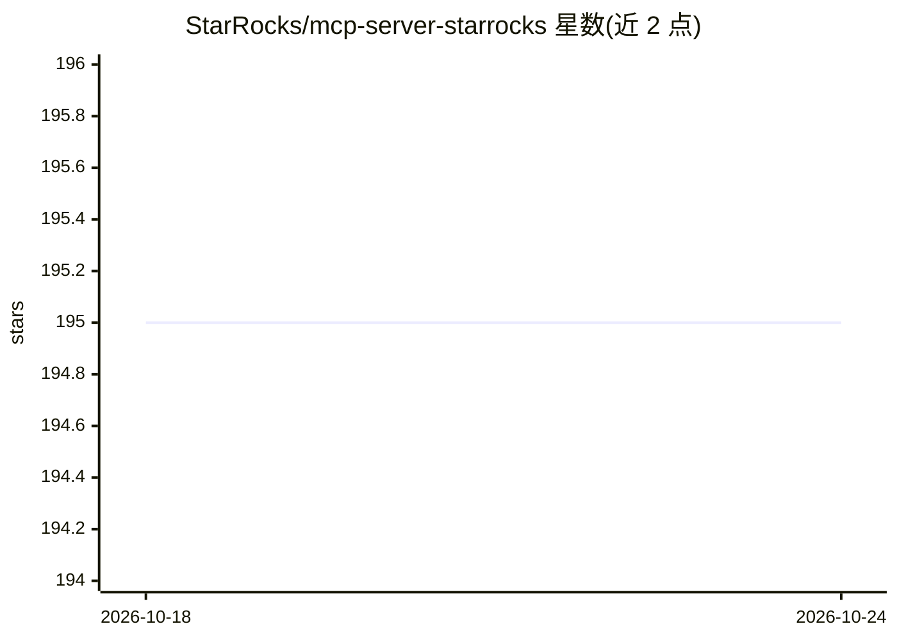

# StarRocks/mcp-server-starrocks

⭐ 195 · Python · Apache-2.0 · 推送 2026-09-08 · [GitHub](https://github.com/StarRocks/mcp-server-starrocks) · 组织维护

**官方 StarRocks MCP 服务器：让 AI 助手操作 StarRocks 数据库**

StarRocks 官方维护的 Model Context Protocol 服务器，作为 AI 助手与 StarRocks 数据库之间的桥接层。提供 SQL 查询执行（SELECT 与 DDL/DML）、数据库/表结构浏览、系统指标访问（proc:// 资源）、表与库的汇总概览（含列定义、行数、样例数据）以及查询结果生成 Plotly 图表等工具。概览结果支持内存缓存。通过 uv 或 Docker 运行，支持 stdio/SSE/HTTP/Streamable HTTP 传输模式，连接参数经环境变量或连接 URL 配置，可选 Arrow Flight SQL 协议。

## 筛选速览

| 维度 | 判定 | 备注 |
|---|---|---|
| AI 角色 | `ai-ecosystem` | LLM/agent 周边工具 |
| 许可风险 | `permissive` | Apache-2.0 |
| 部署形态 | `self-host` | docker 或自建部署 |
| 模型依赖 | — | README 未给出锁定关系 |
| 硬件要求 | — | 无带数字的原话,不猜 |
| 安装摩擦 | `low` | 无编译、无系统依赖或容器化 |
| 成熟度 | — | 结构信号不足 |

## 能力要点

- read_query/write_query 等 SQL 执行工具与 starrocks://、proc:// 资源
- query_and_plotly_chart 从查询结果直接生成 Plotly 图表
- 表/库概览内存缓存，可按需绕过
- 支持 stdio/SSE/HTTP/Streamable HTTP 传输，可选用 Arrow Flight SQL 协议（ADBC）

## 适用场景

- 让 Claude 等 MCP 客户端直接查询与分析 StarRocks 数据
- 通过 AI 助手浏览数据库结构与表统计信息
- 以对话方式生成查询结果可视化图表

## 场景标签

`数据分析` · 领域:效率与自动化

## 证据(README 行号)

> L5: The StarRocks MCP Server acts as a bridge between AI assistants and StarRocks databases. It allows for direct SQL ex
> L13: - **Direct SQL Execution:** Run `SELECT` queries (`read_query`) and DDL/DML commands (`write_query`).

## 星数曲线

2026-10-18 195 → 2026-10-24 195（+0）

---
*卡片 v1 · prompt 1.4 · 生成 2026-10-22 · 置信度 mid · 依据 README sha `6a3c9380bf95` · [字段定义](../../DATASET.md)*
