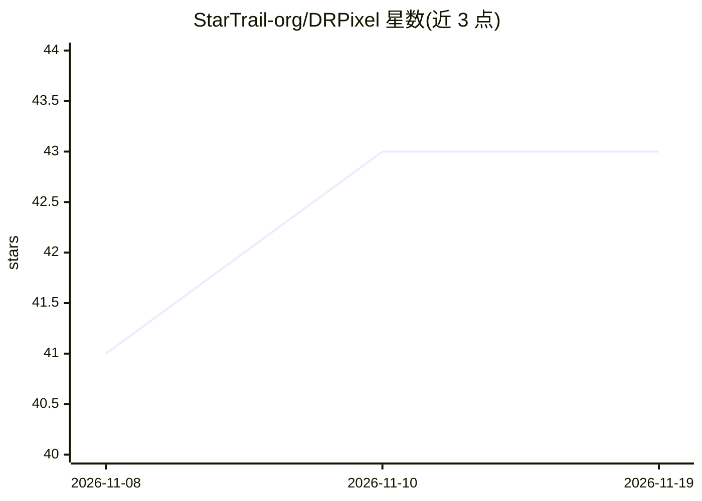

# StarTrail-org/DRPixel

⭐ 43 · Python · Apache-2.0 · 推送 2026-11-02 · [GitHub](https://github.com/StarTrail-org/DRPixel) · 组织维护

**面向科研论文的页面级深度研究基准与评测/训练代码库**

DR Pixel 是论文配套仓库，包含三部分：DRPixelBench 评测 harness（500 道题、99,055 篇论文共 106 万页）、counterfactual credit reweighting 的 SFT 训练代码与数据，以及训练好的开源模型。核心机制：agent 以 ReAct 循环逐页渲染论文，用视觉-语言嵌入模型检索页面图像并直接在图像上推理，规避 OCR 损失表格/图表/公式的问题；评测支持任意 OpenAI 兼容端点。语料数据 473 GB，需从 HuggingFace 数据集获取。面向做深度研究 agent 研究与评测的开发者/科研人员。

## 筛选速览

| 维度 | 判定 | 备注 |
|---|---|---|
| AI 角色 | `ai-ecosystem` | LLM/agent 周边工具 |
| 许可风险 | `permissive` | Apache-2.0 |
| 部署形态 | `library` | 以包/库形式分发 |
| 模型依赖 | — | README 未给出锁定关系 |
| 硬件要求 | — | 无带数字的原话,不猜 |
| 安装摩擦 | `low` | 无编译、无系统依赖或容器化 |
| 成熟度 | — | 结构信号不足 |

## 能力要点

- 页面级（page-native）检索与推理：渲染 150 dpi 页面图像，用 Qwen3-VL-Embedding-8B 嵌入检索
- DRPixelBench：500 道题、1.06M 页、99,055 篇科学论文，一条命令运行并打分
- counterfactual credit reweighting：按步骤对金标答案似然的改变量加权做 SFT
- 训练模型与 2,496 条带逐步权重的轨迹数据已发布

## 适用场景

- 评测自研深度研究 agent 在科学论文问答上的表现
- 复现论文中页面级检索与 OCR 基线的对比实验
- 用 credit reweighting 配方训练开源权重的研究 agent

## 场景标签

`模型评测` `RAG` `科研工具` `微调` · 领域:评测与运维

## 证据(README 行号)

> L46: |`eval/`|the evaluation harness for DRPixelBench, 500 questions over 1.06M pages from 99,055 scientific papers. Poi
> L73: Any endpoint that speaks the OpenAI chat-completions API works, hosted or local. For any other API,

## 星数曲线

2026-11-08 41 → 2026-11-19 43（+2）

---
*卡片 v1 · prompt 1.4 · 生成 2026-11-18 · 置信度 high · 依据 README sha `6db45cc094f5` · [字段定义](../../DATASET.md)*
