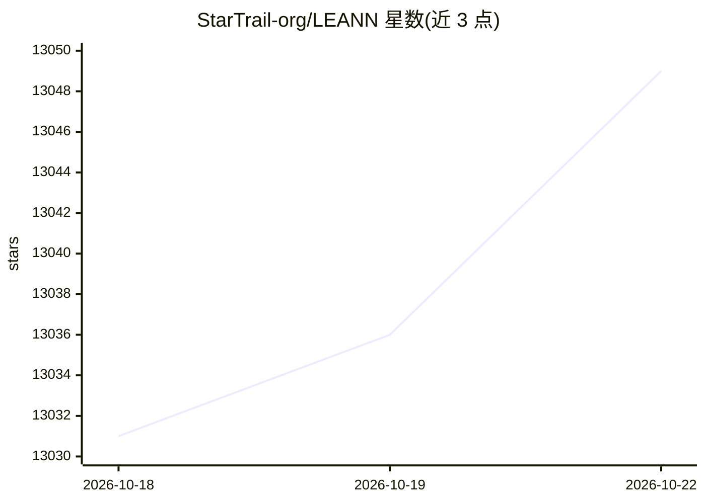

# StarTrail-org/LEANN

⭐ 13,056 · Python · MIT · 推送 2026-10-22 · [GitHub](https://github.com/StarTrail-org/LEANN) · [官网](https://arxiv.org/abs/2506.08276) · 组织维护

**本地优先的轻量向量数据库与 RAG 框架，索引个人数据**

LEANN 是面向个人设备的向量数据库与 RAG 系统，通过图结构选择性重计算与保高度剪枝，按需计算嵌入向量而非全部存储，README 称以约 97% 更少存储（60M 文本块索引 6GB）索引并检索个人数据（文件、邮件、浏览器历史、微信/iMessage 聊天、代码库、MCP 实时数据）。提供声明式 Python API（LeannBuilder/LeannSearcher/LeannChat）与 CLI，支持 OpenAI 兼容接口接入多种 LLM/嵌入提供商，含 Ollama 等本地推理引擎，可作为 Claude Code 的语义搜索 MCP 服务。源码构建需安装 libomp、boost 等系统依赖。

## 筛选速览

| 维度 | 判定 | 备注 |
|---|---|---|
| AI 角色 | `ai-ecosystem` | LLM/agent 周边工具 |
| 许可风险 | `permissive` | MIT |
| 部署形态 | `library` | 以包/库形式分发 |
| 模型依赖 | local-ok | 支持本地模型 |
| 硬件要求 | — | 无带数字的原话,不猜 |
| 安装摩擦 | `high` | 编译与系统依赖俱全 |
| 成熟度 | — | 结构信号不足 |

## 能力要点

- 图结构选择性重计算按需计算嵌入，替代全量嵌入存储
- 支持个人数据源（邮件/浏览器历史/微信/iMessage/agent 记忆/MCP 实时数据）RAG
- 兼容 OpenAI API 格式的 LLM 与嵌入提供商，支持 Ollama/vLLM 等本地引擎
- 可作为 Claude Code 的语义搜索 MCP 服务

## 适用场景

- 在笔记本上对个人文件与聊天记录做本地语义搜索问答
- 为编程 agent 提供代码库语义检索的 MCP 服务
- 在无云端依赖的隐私要求下运行 RAG 应用

## 场景标签

`向量数据库` `RAG` `语义搜索` · 领域:知识与检索

## 证据(README 行号)

> L32: LEANN is an innovative vector database that democratizes personal AI. Transform your laptop into a powerful RAG sys
> L169: from leann import LeannBuilder, LeannSearcher, LeannChat
> L183: LEANN supports many LLM providers for text generation (HuggingFace, Ollama, Anthropic, and Any OpenAI compatible A

## 星数曲线

2026-10-18 13,031 → 2026-10-22 13,049（+18）

---
*卡片 v1 · prompt 1.4 · 生成 2026-10-20 · 置信度 mid · 依据 README sha `6297b8ab92a4` · [字段定义](../../DATASET.md)*
