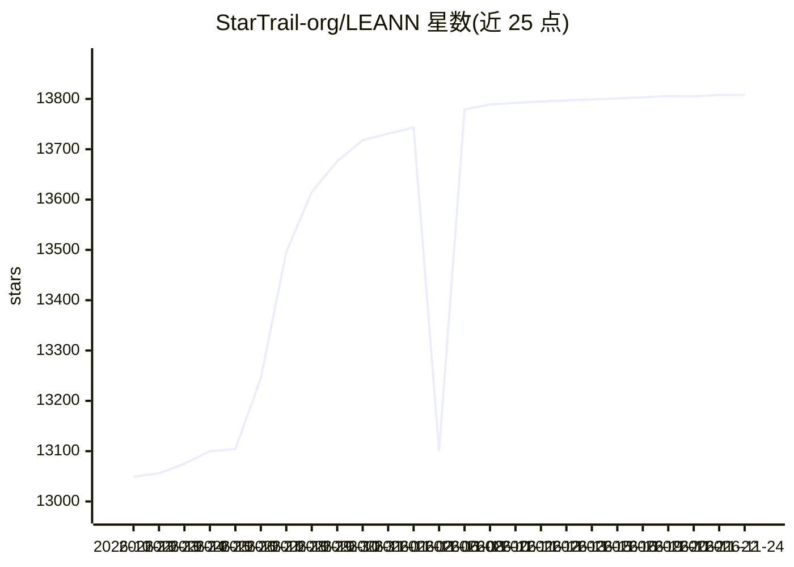

# StarTrail-org/LEANN

⭐ 13,811 · Python · MIT · 推送 2026-11-20 · [GitHub](https://github.com/StarTrail-org/LEANN) · [官网](https://arxiv.org/abs/2506.08276) · 组织维护 · 中文 README

**本地 RAG 向量数据库：在个人设备上省 97% 存储做检索问答**

LEANN 是一个向量数据库与 RAG 工具库，通过图结构选择性重算嵌入（按需计算而非全量存储）实现约 97% 的存储节省。提供 LeannBuilder/LeannSearcher/LeannChat 的 Python API 与 CLI，可对文件系统、邮件、浏览器历史、聊天记录、代码库等数据源建索并进行语义检索与问答，生成端可接 Ollama、OpenAI 兼容端点等多种 LLM 提供方。另可作为 MCP 服务接入 Claude Code 做语义检索。提供 PyPI 安装与多平台源码构建说明，macOS 预编译 wheel 要求 macOS 15+。

## 筛选速览

| 维度 | 判定 | 备注 |
|---|---|---|
| AI 角色 | `ai-native` | 本体是模型或模型工具 |
| 许可风险 | `permissive` | MIT |
| 部署形态 | `library` | 以包/库形式分发 |
| 模型依赖 | local-ok | 支持本地模型 |
| 硬件要求 | `cpu-ok` | |
| 安装摩擦 | `high` | 编译与系统依赖俱全 |
| 成熟度 | — | 结构信号不足 |

## 能力要点

- 图结构选择性重算，按需计算嵌入实现约 97% 存储节省
- 支持对文件、邮件、微信/iMessage、浏览器历史、代码库等数据源建索引
- 通过 OpenAI 兼容格式接入 Ollama/vLLM/llama.cpp 等本地推理引擎与多家云服务
- 提供 MCP 服务形态，兼容 Claude Code 做语义检索

## 适用场景

- 在笔记本上对个人文件与聊天记录做本地语义搜索和问答
- 给 Claude Code 加装语义检索 MCP 服务替代关键词搜索
- 构建不联网、数据不出本机的私有 RAG 应用
- 在代码库上为编码 agent 提供相关代码检索

## 场景标签

`RAG` `向量数据库` `语义搜索` `文档问答` · 领域:知识与检索

## 证据(README 行号)

> L30:  The smallest vector index in the world. RAG Everything with LEANN!
> L32: LEANN is an innovative vector database that democratizes personal AI. Transform your laptop into a powerful RAG sys
> L36: **Ready to RAG Everything?** Transform your laptop into a personal AI assistant that can semantic search your **fil

## 星数曲线

2026-10-22 13,049 → 2026-11-24 13,808（+759）

---
*卡片 v1 · prompt 1.4 · 生成 2026-11-23 · 置信度 mid · 依据 README sha `fda8cedf37eb` · [字段定义](../../DATASET.md)*
