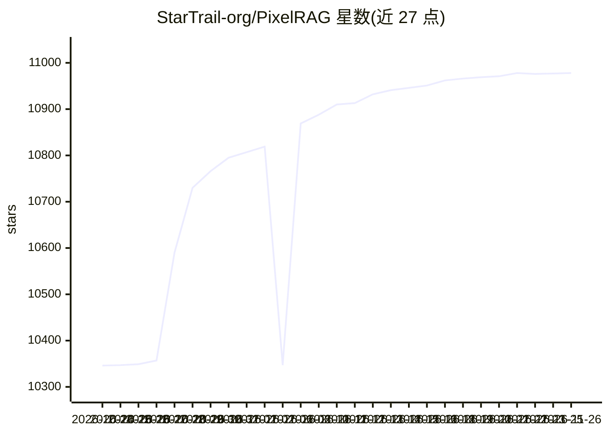

# StarTrail-org/PixelRAG

⭐ 10,978 · Python · Apache-2.0 · 推送 2026-11-24 · [GitHub](https://github.com/StarTrail-org/PixelRAG) · [官网](https://arxiv.org/pdf/2606.28344) · 组织维护

**开发者视觉检索工具：以截图为索引检索网页/PDF内容**

论文 PIXELRAG 的官方代码库：将网页、PDF、图像渲染为截图切片，在图像上直接进行检索，保留 HTML 解析会丢失的表格、图表与版式信息。核心是 LoRA 微调的 Qwen3-VL-Embedding 嵌入模型与 FAISS/Qdrant 索引，管线分 render/embed/index/serve 各阶段独立安装；托管端点提供 8.28M Wikipedia 页面的预建索引，并附 Claude Code 插件 pixelbrowse 与训练配方。需要 Python 3.10+，索引构建支持 Linux CUDA 与 Apple Silicon。

## 筛选速览

| 维度 | 判定 | 备注 |
|---|---|---|
| AI 角色 | `ai-native` | 本体是模型或模型工具 |
| 许可风险 | `permissive` | Apache-2.0 |
| 部署形态 | `self-host` | docker 或自建部署 |
| 模型依赖 | locked-api |  |
| 硬件要求 | `cpu-ok` | |
| 安装摩擦 | `low` | 无编译、无系统依赖或容器化 |
| 成熟度 | — | 结构信号不足 |

## 能力要点

- 渲染为截图切片后直接在图像上检索，保留表格/图表/版式
- Qwen3-VL-Embedding LoRA 微调模型，适配器与训练集已发布
- 托管端点 api.pixelrag.ai 服务 8.28M Wikipedia 页面预建索引，支持图像查询
- 提供 Claude Code 插件 pixelbrowse 与 opencode npm 插件

## 适用场景

- 让 agent 截图网页后直接读取图表和表格内容
- 为自己的 PDF/网页文档建立本地视觉检索索引
- 通过托管 API 对 Wikipedia 做视觉搜索

## 场景标签

`RAG` `多模态` `微调` · 领域:知识与检索

## 证据(README 行号)

> L53: PixelRAG renders documents — web pages, PDFs, images — as screenshots and retrieves over the
> L104: Two pieces make this work: (1) rendering documents to images instead of parsing them to text, and
> L105: (2) a `Qwen3-VL-Embedding` model, LoRA-fine-tuned on screenshot data, that embeds page images into

## 星数曲线

2026-10-24 10,346 → 2026-11-26 10,978（+632）

---
*卡片 v1 · prompt 1.4 · 生成 2026-11-23 · 置信度 high · 依据 README sha `c640511788a6` · [字段定义](../../DATASET.md)*
