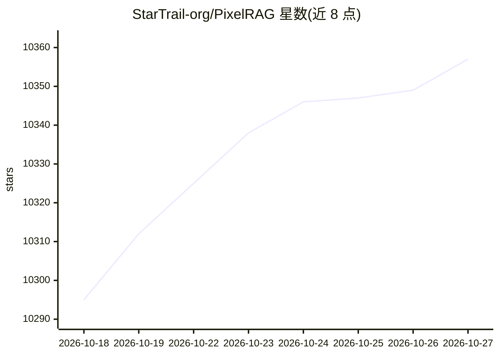

# StarTrail-org/PixelRAG

⭐ 10,357 · Python · Apache-2.0 · 推送 2026-10-24 · [GitHub](https://github.com/StarTrail-org/PixelRAG) · [官网](https://arxiv.org/pdf/2606.28344) · 组织维护

**把网页/PDF渲染成截图做视觉检索的 RAG 管线**

论文官方代码库：将网页、PDF、图像渲染为截图分块，用 LoRA 微调的 Qwen3-VL-Embedding 模型将页面图像嵌入向量空间，经 FAISS（或 Qdrant）索引后按图像直接检索，保留表格、图表与版式信息。管线拆为 pixelshot 渲染、chunk/embed/build-index、serve API 等可独立安装的阶段；另提供 8.28M 维基百科页面预构建索引的托管端点、Claude Code 的 pixelbrowse 技能插件与 opencode 插件。PDF 渲染需可选 poppler 依赖；训练为独立 uv 项目，适配器与训练集已公开。

## 筛选速览

| 维度 | 判定 | 备注 |
|---|---|---|
| AI 角色 | `ai-ecosystem` | LLM/agent 周边工具 |
| 许可风险 | `permissive` | Apache-2.0 |
| 部署形态 | `library` | 以包/库形式分发 |
| 模型依赖 | locked-api |  |
| 硬件要求 | `cpu-ok` | |
| 安装摩擦 | `medium` | 含编译或系统依赖之一 |
| 成熟度 | — | 结构信号不足 |

## 能力要点

- 文档渲染为截图分块，Qwen3-VL-Embedding(LoRA) 图像嵌入检索
- FAISS 默认后端，可选 Qdrant（量化/磁盘向量/payload 过滤）
- 8.28M 维基百科预构建索引托管端点 api.pixelrag.ai，无需 API key
- Claude Code 插件 pixelbrowse：截图后让模型直接读图

## 适用场景

- 对含表格/图表/版式的网页或 PDF 做保留视觉结构的问答检索
- 让 Claude/opencode 等编程 agent 通过截图'看'网页
- 用自有文档构建本地视觉检索索引（macOS Apple Silicon 或 Linux）

## 场景标签

`RAG` `语义搜索` `多模态` `文档问答` · 领域:知识与检索

## 证据(README 行号)

> L53: PixelRAG renders documents — web pages, PDFs, images — as screenshots and retrieves over the
> L104: Two pieces make this work: (1) rendering documents to images instead of parsing them to text, and
> L105: (2) a `Qwen3-VL-Embedding` model, LoRA-fine-tuned on screenshot data, that embeds page images into

## 星数曲线

2026-10-18 10,295 → 2026-10-27 10,357（+62）

---
*卡片 v1 · prompt 1.4 · 生成 2026-10-20 · 置信度 high · 依据 README sha `b5b26ce2be83` · [字段定义](../../DATASET.md)*
