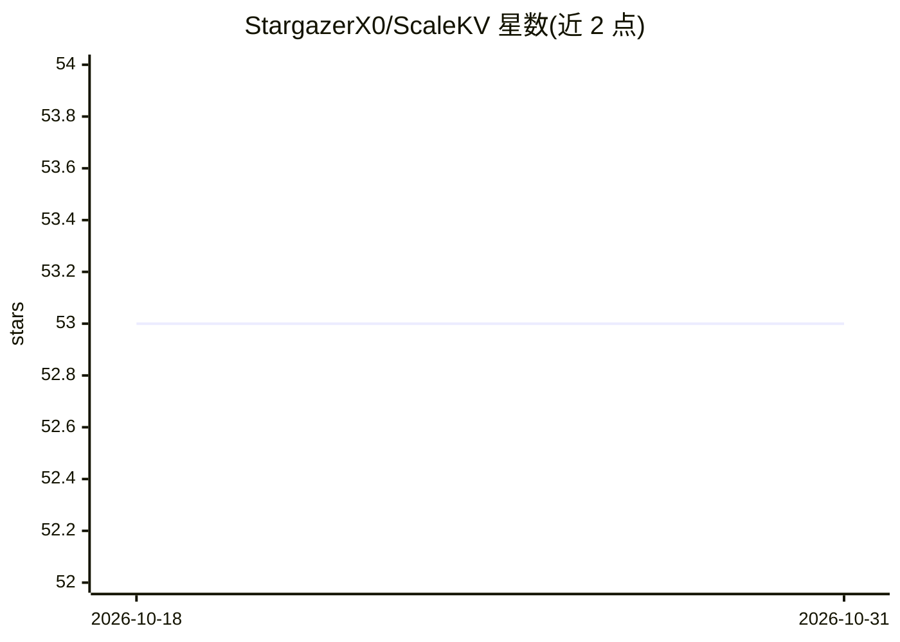

# StargazerX0/ScaleKV

⭐ 53 · Python · MIT · 推送 2026-03-13 · [GitHub](https://github.com/StargazerX0/ScaleKV) · [官网](https://arxiv.org/abs/2505.19602) · 组织维护

**面向视觉自回归模型的 KV Cache 压缩框架（NeurIPS 2025 论文代码）**

ScaleKV 是针对 VAR 下一尺度预测范式的 KV Cache 压缩框架：将 transformer 层分为 drafters 与 refiners 两组功能层，按层角色与各尺度注意力模式实施自适应缓存管理。在 Infinity-8B 上实现 85 GB 到 8.5 GB 的内存降低（10x），GenEval 分数保持 0.79，DPG 分数从 86.61 降至 86.49。提供 pip 安装依赖、Hugging Face 下载 Infinity-2B/8B 与 flan-t5-xl 权重、推理与 COCO 采样评测脚本。供视觉自回归图像生成研究者使用。

## 筛选速览

| 维度 | 判定 | 备注 |
|---|---|---|
| AI 角色 | `ai-ecosystem` | LLM/agent 周边工具 |
| 许可风险 | `permissive` | MIT |
| 部署形态 | `library` | 以包/库形式分发 |
| 模型依赖 | — | README 未给出锁定关系 |
| 硬件要求 | — | 无带数字的原话,不猜 |
| 安装摩擦 | `low` | 无编译、无系统依赖或容器化 |
| 成熟度 | — | 结构信号不足 |

## 能力要点

- 按 drafters/refiners 层角色做自适应 KV Cache 分配
- Infinity-8B 上 10x 内存降低（85 GB→8.5 GB），质量指标基本保持
- 提供 2B/8B 推理、批量采样与 PSNR/LPIPS/FID 指标计算脚本

## 适用场景

- 在有限显存下运行 Infinity 视觉自回归图像生成
- 复现论文中 KV Cache 压缩的质量与内存指标
- 研究自回归模型不同层的缓存需求差异

## 场景标签

`图像生成` `模型量化` · 领域:内容生成

## 证据(README 行号)

> L17: We propose Scale-Aware KV Cache (ScaleKV), a novel KV Cache compression framework tailored for VAR’s next-scale pre
> L33: Download google flan-t5-xl:
> L47: huggingface-cli download FoundationVision/Infinity --include "infinity_8b_weights/**" --local-dir ./weights/infinit

## 星数曲线

2026-10-18 53 → 2026-10-31 53（+0）

---
*卡片 v1 · prompt 1.4 · 生成 2026-10-24 · 置信度 high · 依据 README sha `59862375e3db` · [字段定义](../../DATASET.md)*
