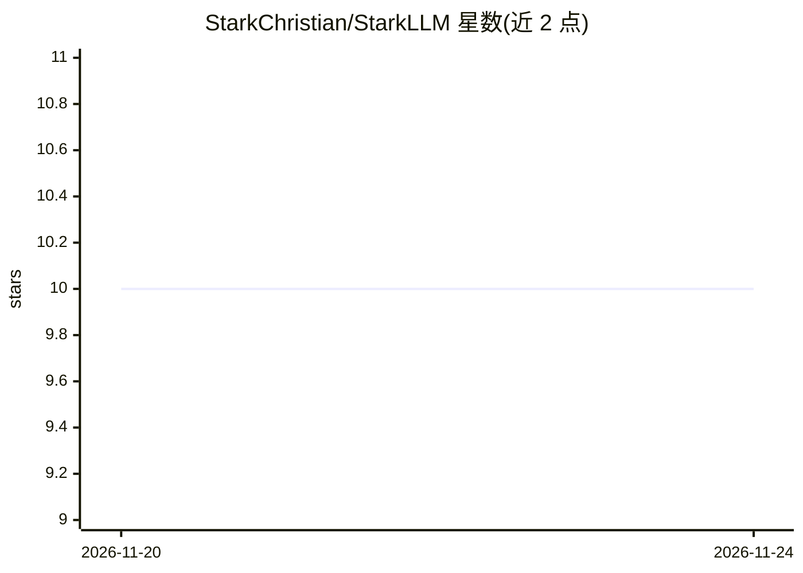

# StarkChristian/StarkLLM

⭐ 10 · Python · Apache-2.0 · 推送 2026-11-23 · [GitHub](https://github.com/StarkChristian/StarkLLM) · [官网](https://www.starkllm.com) · 个人维护

**Windows 本地文档问答助手，模型经 Ollama 在本机运行**

面向 Windows 的开源桌面助手（Electron 应用，Apache 2.0），读取本地 PDF、Word、EPUB、演示文稿、照片与扫描件，回答问题并标注答案所在页码，从信件中提取类型、发件人、金额与截止日期并支持提醒和 .ics 导出。AI 模型经 Ollama 在本机运行，文件与对话默认留在本地，联网功能（DuckDuckGo 搜索、云模型商、YouTube/GitHub 导入等）需手动开启，提供

## 筛选速览

| 维度 | 判定 | 备注 |
|---|---|---|
| AI 角色 | `ai-native` | 本体是模型或模型工具 |
| 许可风险 | `permissive` | Apache-2.0 |
| 部署形态 | `desktop` | 安装包/桌面程序 |
| 模型依赖 | local-ok | 支持本地模型 |
| 硬件要求 | — | 无带数字的原话,不猜 |
| 安装摩擦 | `low` | 无编译、无系统依赖或容器化 |
| 成熟度 | — | 结构信号不足 |

## 能力要点

- 文档问答附页码出处，引用不在文档中的句子会被标记
- 信件收件箱：逐字提取发件人、金额、截止日期并提示可疑诈骗信
- 模型经 Ollama 本机运行，应用可完全离线且无遥测
- 支持 NVIDIA、AMD Radeon、Intel Arc 显卡，安装器自带引擎无需 Docker

## 适用场景

- 对本地 PDF、电子书、演示文稿提问并获取页码出处
- 整理信件中的截止日期、金额并导出日历提醒
- 在无网络环境下处理隐私敏感文档

## 场景标签

`文档问答` · 领域:知识与检索

## 证据(README 行号)

> L9: **StarkLLM** is a free, open source assistant for your own documents and letters on Windows. It runs in its own desk
> L12: through Ollama.
> L21: - 📄 **Questions about your documents** with the page and line each answer comes from; quotations that are not in yo

## 星数曲线

2026-11-20 10 → 2026-11-24 10（+0）

---
*卡片 v1 · prompt 1.4 · 生成 2026-11-20 · 置信度 high · 依据 README sha `679066ddb07d` · [字段定义](../../DATASET.md)*
