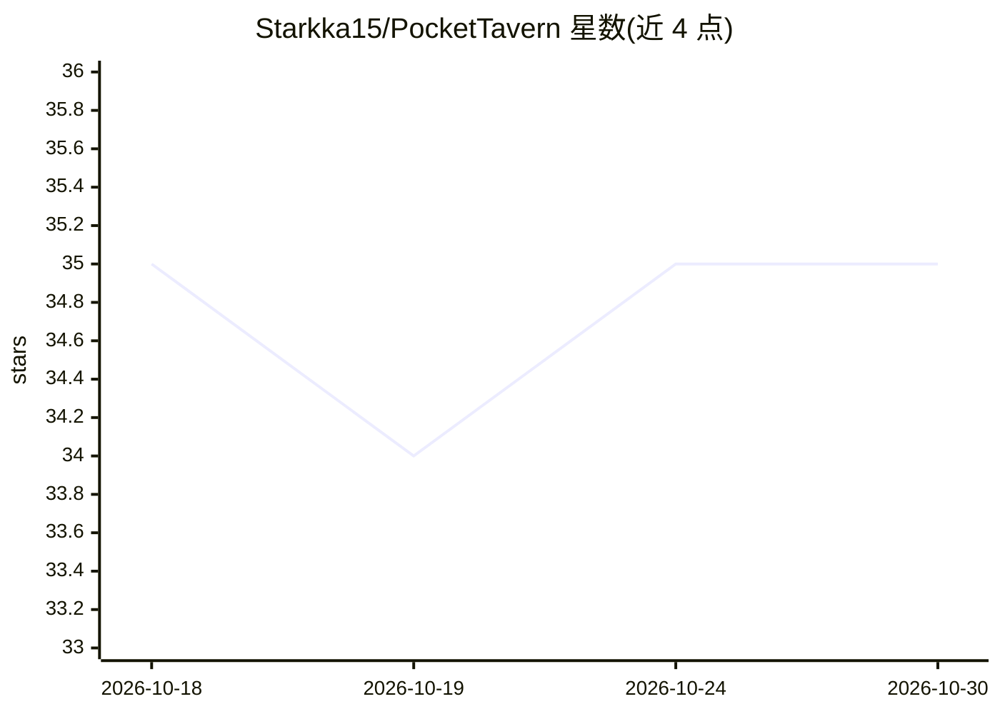

# Starkka15/PocketTavern

⭐ 35 · Kotlin · NOASSERTION · 推送 2026-10-09 · [GitHub](https://github.com/Starkka15/PocketTavern) · 个人维护 · 中文 README

**Android 上的 SillyTavern 兼容 AI 聊天客户端**

面向 Android 用户的源码可用 AI 角色扮演聊天应用：直接连接用户自选的 LLM 后端（本地 llama.cpp/Ollama/vLLM/KoboldCpp 或 OpenAI/Anthropic 等云 API），无需中转服务器与账号。数据以 SillyTavern 兼容格式（PNG 角色卡、Lorebook）本地存储，支持群聊、斜杠命令、长期记忆压缩、TTS 与 JavaScript 扩展 API。以 APK 安装包分发，非商业用途限制许可。

## 筛选速览

| 维度 | 判定 | 备注 |
|---|---|---|
| AI 角色 | `ai-native` | 本体是模型或模型工具 |
| 许可风险 | `none` | NOASSERTION |
| 部署形态 | `desktop` | 安装包/桌面程序 |
| 模型依赖 | local-ok | 支持本地模型 |
| 硬件要求 | — | 无带数字的原话,不猜 |
| 安装摩擦 | `low` | 无编译、无系统依赖或容器化 |
| 成熟度 | — | 结构信号不足 |

## 能力要点

- 直连 40+ 种文本/聊天补全后端（本地与云端），支持连接配置切换
- SillyTavern 兼容的角色卡（.png/.charx）本地存储与导入导出
- 多角色群聊、共享 World Book、斜杠命令与 AI 长期记忆压缩
- 系统 TTS 或 OpenAI 兼容 TTS 服务器的语音朗读

## 适用场景

- 在手机上与本地或云端模型进行角色扮演聊天
- 导入已有 SillyTavern 角色卡继续对话
- 多人设群聊并维护共享世界观设定

## 场景标签

`聊天机器人` · 领域:对话与助手

## 证据(README 行号)

> L24: PocketTavern is free, source-available, and always will be. It connects directly to whatever LLM backend you choose

## 星数曲线

2026-10-18 35 → 2026-10-30 35（+0）

---
*卡片 v1 · prompt 1.4 · 生成 2026-10-25 · 置信度 high · 依据 README sha `cda96d7d5b04` · [字段定义](../../DATASET.md)*
