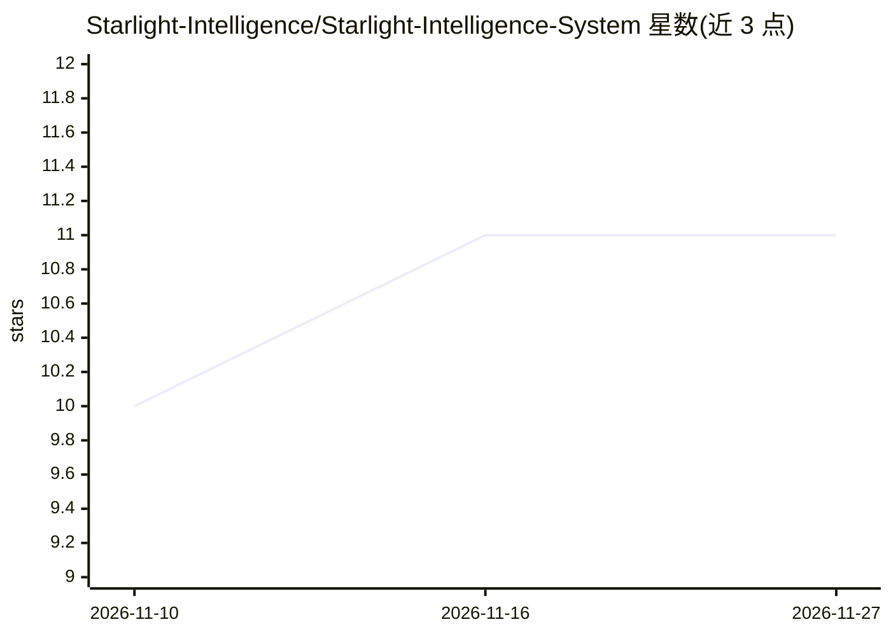

# Starlight-Intelligence/Starlight-Intelligence-System

⭐ 11 · TypeScript · MIT · 推送 2026-11-26 · [GitHub](https://github.com/Starlight-Intelligence/Starlight-Intelligence-System) · [官网](https://starlightintelligence.org/protocol) · 个人维护

**为多 AI 编码工具提供共享持久记忆与治理的 MCP 基础设施**

由 SIP 开放协议与 SIS 参考实现组成的双层系统：各 agent 工具通过 MCP server 读写同一组六个语义 JSONL vault（SQLite+FTS5 索引），带出处证明（attestation）、时间衰减与矛盾检测。提供 13 个 sis_* MCP 工具、151 个 agent 定义、slash 命令集与 Estate Factory 多 agent 编排模式。面向在 Claude Code、Cursor、Codex、Gemini CLI 等多个工具间需要共享记忆的开发者；模块化可只用协议、只用记忆层或运行完整系统。

## 筛选速览

| 维度 | 判定 | 备注 |
|---|---|---|
| AI 角色 | `ai-ecosystem` | LLM/agent 周边工具 |
| 许可风险 | `permissive` | MIT |
| 部署形态 | `library` | 以包/库形式分发 |
| 模型依赖 | — | README 未给出锁定关系 |
| 硬件要求 | — | 无带数字的原话,不猜 |
| 安装摩擦 | `low` | 无编译、无系统依赖或容器化 |
| 成熟度 | — | 结构信号不足 |

## 能力要点

- 六个语义 vault + SQLite/FTS5 索引，多工具共享同一份记忆
- MCP server 暴露 13 个 sis_* 工具，适配各平台客户端
- SIP 协议含文件契约、attestation、MCP registry 等六层规范
- Estate Factory 模式用于大规模多 agent 系统编排

## 适用场景

- 让 Claude Code 与 Cursor 等多个 agent 工具共享同一份项目记忆
- 按 SIP 协议规范自己的 agent 技能/记忆文件格式
- 为多 agent 团队搭建带治理与评估的编排底座

## 场景标签

`Agent 记忆` `多智能体` · 领域:Agent 开发

## 证据(README 行号)

> L9: Claude Code, Cursor, Codex, Gemini CLI, OpenCode, Antigravity — they all read from and write to the **same six seman
> L54: Starlight Intelligence System (SIS) is the **sovereign AI substrate** for memory, orchestration, skills, governance
> L198: MCP Server — 13 sis_* tools exposed uniformly to every platform adapter.

## 星数曲线

2026-11-10 10 → 2026-11-27 11（+1）

---
*卡片 v1 · prompt 1.4 · 生成 2026-11-18 · 置信度 high · 依据 README sha `db4f82debb02` · [字段定义](../../DATASET.md)*
