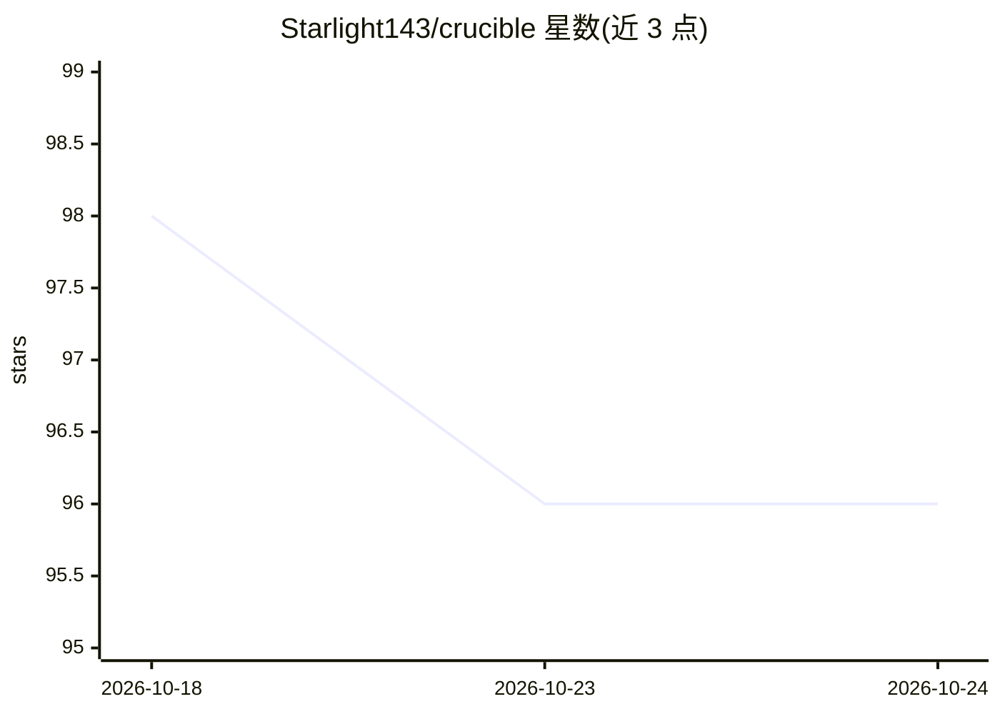

# Starlight143/crucible

⭐ 96 · Python · NOASSERTION · 推送 2026-07-08 · [GitHub](https://github.com/Starlight143/crucible) · 个人维护 · 中文 README

**多智能体研究引擎：一行想法产出结构化分析报告与可运行代码**

面向投资研究、SaaS 产品分析、agent 架构评估与论文复现的多智能体研究工作流：输入一句话想法、项目目录或论文标题，经 Web 研究、三路并行调研、七方向辩论等五阶段流水线，输出含共识/分歧/风险/终止准则的结构化报告及可运行代码；证据不足时质量门自动中止流水线。支持 OpenRouter、Alibaba Coding Plan 或本地 Ollama 三种 LLM 接入，提供 WebUI（Gunicorn 部署）与 CLI，声明 255+ 自动化测试。许可为 AGPL v3（个人/开源/学术用途免费）。

## 筛选速览

| 维度 | 判定 | 备注 |
|---|---|---|
| AI 角色 | `ai-native` | 本体是模型或模型工具 |
| 许可风险 | `none` | NOASSERTION |
| 部署形态 | `library` | 以包/库形式分发 |
| 模型依赖 | local-ok | 支持本地模型 |
| 硬件要求 | — | 无带数字的原话,不猜 |
| 安装摩擦 | `low` | 无编译、无系统依赖或容器化 |
| 成熟度 | — | 结构信号不足 |

## 能力要点

- 五阶段流水线：Web 研究+引用 → 三路并行调研 → 辩论 → 风险门控分析
- 证据不足时质量门自动中止，不做无依据输出
- 声明可追溯性：每个论断有引用来源，每个决策有分析师依据链
- 三种 LLM 接入：OpenRouter / Alibaba Coding Plan / 本地 Ollama（无需 key）

## 适用场景

- 量化研究者快速验证策略想法并跑回测出 tearsheet
- SaaS 产品构建者分析市场、竞品与采用障碍
- 学术研究者复现与消融论文，AI agent 开发者评估架构合理性
- 指向已有项目目录做分析、修 bug（仅做增量修改，保留现有 API）

## 场景标签

`多智能体` `科研工具` · 领域:Agent 开发

## 证据(README 行号)

> L13: > An AI-native multi-agent research engine for investment research, SaaS product analysis, agent architecture evalu
> L18: **Output** — a structured analysis report (consensus / disagreement / risks / kill criteria) **plus runnable code**

## 星数曲线

2026-10-18 98 → 2026-10-24 96（-2）

---
*卡片 v1 · prompt 1.4 · 生成 2026-10-23 · 置信度 high · 依据 README sha `23a17658bfc4` · [字段定义](../../DATASET.md)*
