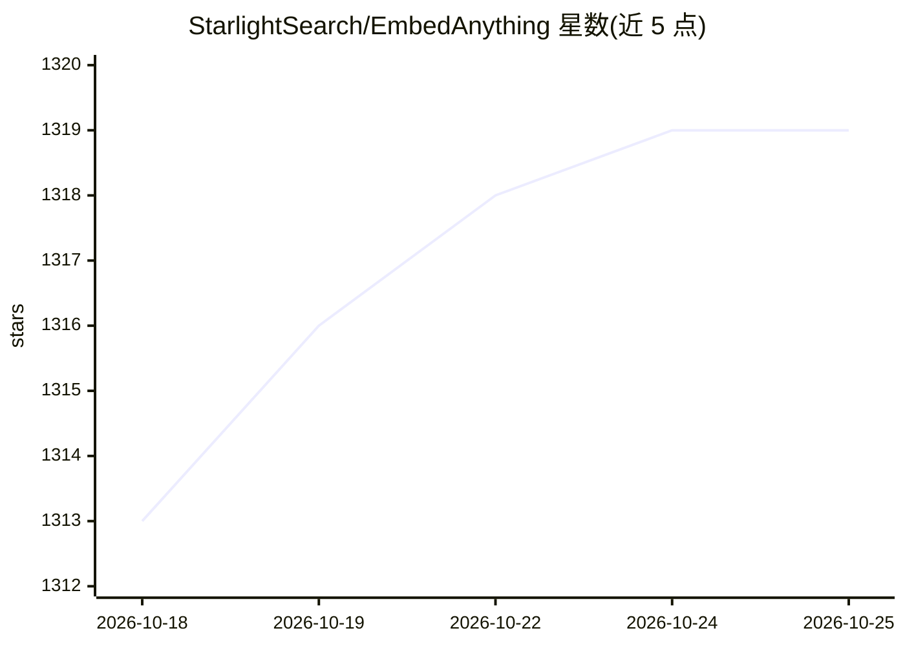

# StarlightSearch/EmbedAnything

⭐ 1,319 · Rust · Apache-2.0 · 推送 2026-09-25 · [GitHub](https://github.com/StarlightSearch/EmbedAnything) · [官网](https://embed-anything.com/) · 组织维护

**Rust 编写的多模态嵌入推理与索引流水线库**

用 Rust 实现并以 Python（pyo3 绑定）提供的嵌入生成库：从文本、PDF、Markdown、图片 JPG、音频 WAV、网页、视频抽帧等多源读取数据，经内置 chunking（语义/late-chunking）后运行嵌入模型（Candle 或 ONNX 后端，支持 dense、sparse、late-interaction、model2vec 及 Cohere 云端模型），并以 vector streaming 方式写入 Elastic、Weaviate、Pinecone、Qdrant、Milvus、Chroma 等向量数据库。面向 AI 工程师做检索/RAG 数据接入，无 PyTorch 依赖，提供 Docker 服务端镜像。

## 筛选速览

| 维度 | 判定 | 备注 |
|---|---|---|
| AI 角色 | `ai-ecosystem` | LLM/agent 周边工具 |
| 许可风险 | `permissive` | Apache-2.0 |
| 部署形态 | `library` | 以包/库形式分发 |
| 模型依赖 | — | README 未给出锁定关系 |
| 硬件要求 | — | 无带数字的原话,不猜 |
| 安装摩擦 | `medium` | 含编译或系统依赖之一 |
| 成熟度 | — | 结构信号不足 |

## 能力要点

- 多源多模态摄入：PDF/txt/md/图片/音频/网页/视频抽帧
- Candle 与 ONNX 双后端，支持 Hugging Face 模型与私有 gated 模型
- 内置语义 chunking 与 late-chunking
- 嵌入结果流式写入 6 种向量数据库适配器

## 适用场景

- 我想为 RAG 系统把本地文档批量嵌入并写入向量数据库
- 我需要在不同文件类型上跑同一套嵌入流水线
- 我想用 ONNX 后端在本地运行 BERT/ColPali/Colbert 等嵌入模型

## 场景标签

`RAG` `多模态` · 领域:知识与检索

## 证据(README 行号)

> L26: EmbedAnything is a minimalist, yet highly performant, modular, lightning-fast, lightweight, multisource, multimodal
> L309: One of the aims of EmbedAnything is to allow AI engineers to easily use state of the art embedding models on typic

## 星数曲线

2026-10-18 1,313 → 2026-10-25 1,319（+6）

---
*卡片 v1 · prompt 1.4 · 生成 2026-10-21 · 置信度 high · 依据 README sha `3a291ce15cbe` · [字段定义](../../DATASET.md)*
