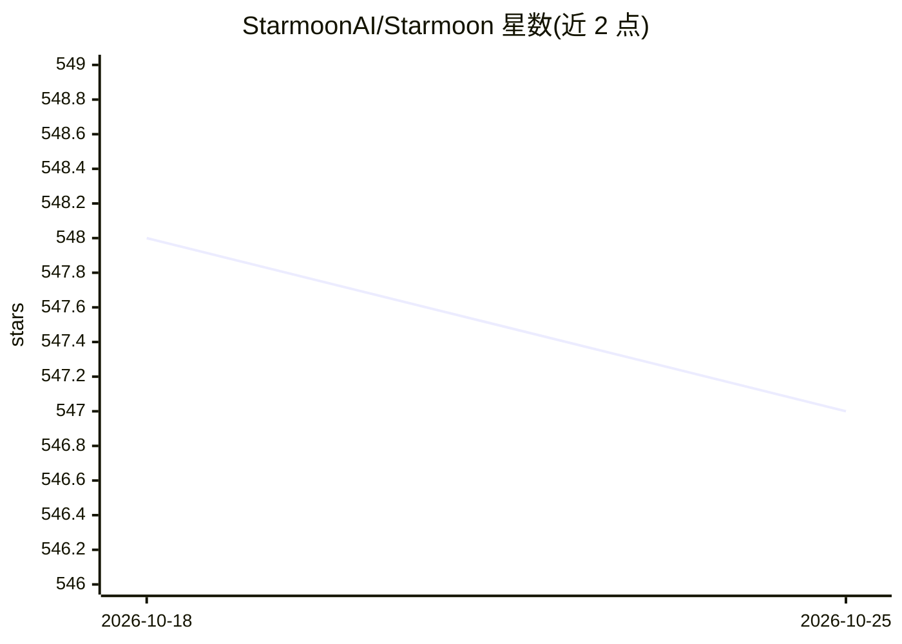

# StarmoonAI/Starmoon

⭐ 547 · TypeScript · GPL-3.0 · 推送 2026-03-27 · [GitHub](https://github.com/StarmoonAI/Starmoon) · [官网](https://www.elatoai.com) · 组织维护

**开源 ESP32 对话 AI 伴侣设备的软硬件框架**

面向 DIY 硬件爱好者的便携对话 AI 设备项目：以 ESP32-S3 开发板、INMP441 麦克风、MAX98357A 功放等元件自行组装，配合 PlatformIO 烧录固件，通过手机连接设备 WiFi（仅 2.4GHz）并用 Starmoon API key 完成配置。功能包括语音对话、情绪理解与回应、自定义 AI 角色、趋势面板；支持本地自部署。项目已声明停止维护，后续工作转入 ElatoAI。

## 筛选速览

| 维度 | 判定 | 备注 |
|---|---|---|
| AI 角色 | `ai-native` | 本体是模型或模型工具 |
| 许可风险 | `viral` | GPL-3.0 |
| 部署形态 | `None` |  |
| 模型依赖 | — | README 未给出锁定关系 |
| 硬件要求 | — | 无带数字的原话,不猜 |
| 安装摩擦 | `low` | 无编译、无系统依赖或容器化 |
| 成熟度 | — | 结构信号不足 |

## 能力要点

- ESP32-S3 硬件组装 + PlatformIO 固件烧录的完整流程
- 语音对话与实时情绪理解分析
- 自定义 AI 角色与趋势面板
- 支持本地部署与自托管

## 适用场景

- 自制一个可随身携带的对话 AI 伴侣设备
- 为自己的 AI 角色搭建实体语音交互载体
- DIY 机器人/IoT 语音设备的学习与实践

## 场景标签

`语音 Agent` · 领域:对话与助手

## 证据(README 行号)

> L9: # &nbsp;Starmoon - A fully open-source, compact, conversational AI device to chat with custom AI characters
> L44: - **Voice-enabled emotional intelligence**: Understand and analyze insights in your emotions through your conversat

## 星数曲线

2026-10-18 548 → 2026-10-25 547（-1）

---
*卡片 v1 · prompt 1.4 · 生成 2026-10-23 · 置信度 high · 依据 README sha `ae8b08aa024a` · [字段定义](../../DATASET.md)*
