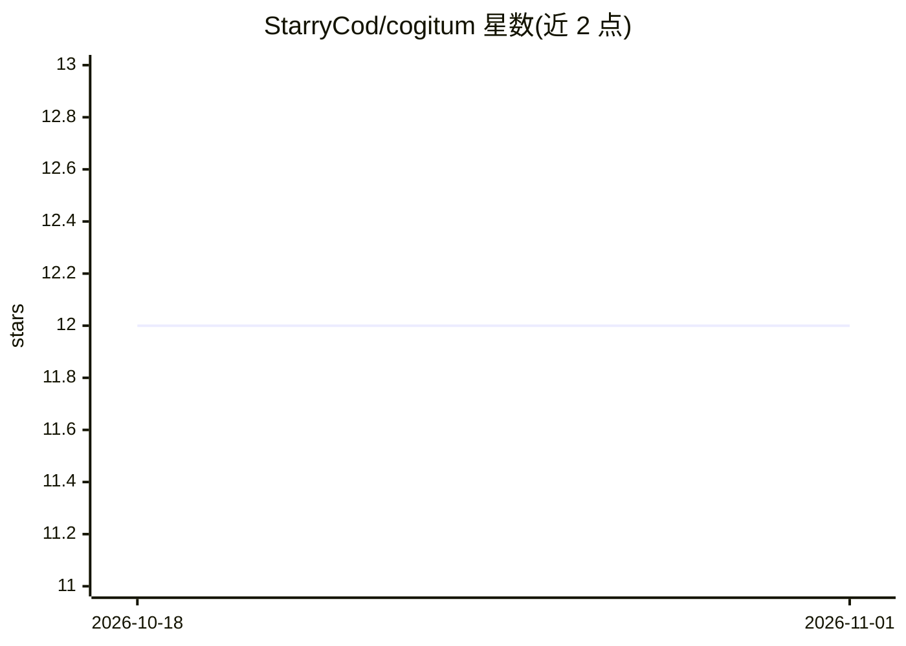

# StarryCod/cogitum

⭐ 12 · Python · MIT · 推送 2026-05-25 · [GitHub](https://github.com/StarryCod/cogitum) · [官网](https://www.npmjs.com/package/cogitum) · 个人维护

**终端原生多供应商 AI agent CLI：TUI 对话、工具调用与会话持久化**

基于 Textual TUI 的终端 AI agent，面向习惯命令行的工程师。通过多供应商 LLM mesh 接入 OpenAI、Anthropic、OpenRouter、Groq 等端点，提供自动故障转移、密钥池与限流跟踪；内置 17 种工具（终端、Playwright 浏览器、文件读写、web 搜索等）、83 个捆绑技能、跨会话记忆、JSONL 持久会话、git 式内容寻址快照系统 cogit、MCP 集成、Telegram 网关，以及默认关闭的递归并行 swarm（Cogitator Legion，实验性）。安装途径为 npm 薄启动器、bash/PowerShell 一行脚本或源码 pip 安装，要求 Python 3.11+。

## 筛选速览

| 维度 | 判定 | 备注 |
|---|---|---|
| AI 角色 | `ai-native` | 本体是模型或模型工具 |
| 许可风险 | `permissive` | MIT |
| 部署形态 | `library` | 以包/库形式分发 |
| 模型依赖 | locked-api |  |
| 硬件要求 | — | 无带数字的原话,不猜 |
| 安装摩擦 | `low` | 无编译、无系统依赖或容器化 |
| 成熟度 | `idea` | |

## 能力要点

- 多供应商 mesh：自动故障转移、密钥池、限流跟踪
- 17 个内置工具 + 83 个捆绑技能 + 自学习技能生成
- cogit 内容寻址快照系统，破坏性操作前自动存档
- Cogitator Legion 递归并行 swarm（默认关闭，实验性）

## 适用场景

- 在终端里让 agent 执行编码、研究、MLOps 等任务
- 跨多个 LLM 供应商负载均衡并在限流下保持长会话
- 通过 Telegram 远程使用同一 agent

## 场景标签

`AI 助手` `编码 Agent` `浏览器自动化` `模型网关` · 领域:Agent 开发

## 证据(README 行号)

> L21: > **Cogitum** is a terminal-native AI agent with a multi-provider LLM mesh, 17 built-in tools, persistent sessions,
> L27: |🕸️ **Multi-Provider Mesh**|Load-balance across OpenAI, Anthropic, OpenRouter, Cerebras, Groq, CanopyWave, and any 

## 星数曲线

2026-10-18 12 → 2026-11-01 12（+0）

---
*卡片 v1 · prompt 1.4 · 生成 2026-11-01 · 置信度 high · 依据 README sha `95f67cde9416` · [字段定义](../../DATASET.md)*
