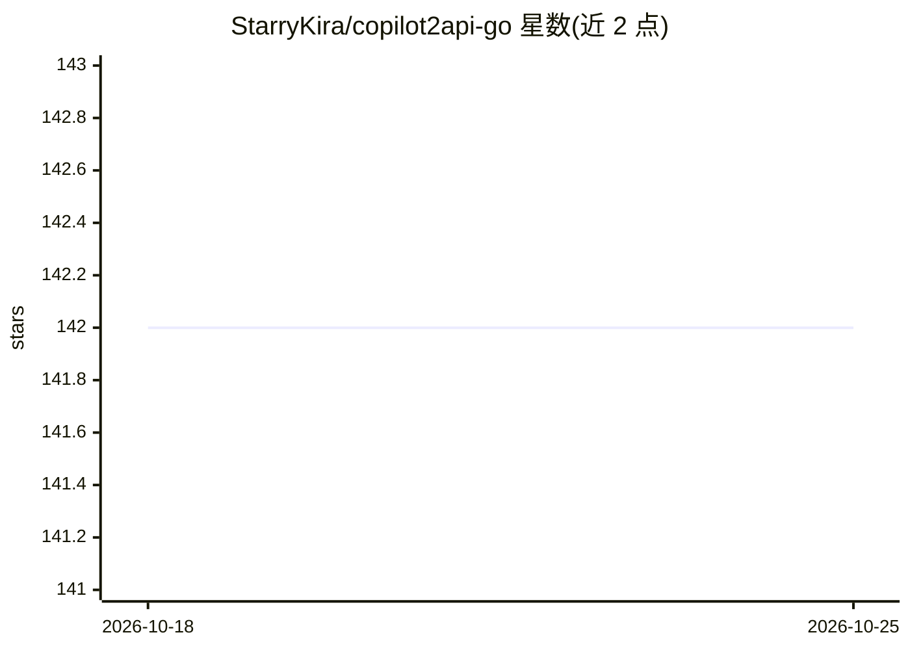

# StarryKira/copilot2api-go

⭐ 142 · Go · 推送 2026-07-05 · [GitHub](https://github.com/StarryKira/copilot2api-go) · 个人维护 · 中文 README

**将 GitHub Copilot 转为 OpenAI/Anthropic 兼容 API 的 Go 代理**

基于官方 GitHub Copilot CLI SDK 的 API 代理服务，把 Copilot 订阅暴露为 OpenAI（/v1/chat/completions、/v1/models、/v1/embeddings）与 Anthropic（/v1/messages）兼容端点，自动做协议与模型 ID 双向翻译，支持流式 SSE。提供 Web 控制台管理多个 GitHub 账号（OAuth 设备流认证），并以 Pool 模式做轮询/优先级/智能负载均衡。以 Docker 镜像或 Go 源码编译运行，数据持久化于 ~/.local/share/copilot-api/。限制：需有效的 GitHub Copilot 订阅，使用前需阅读 Copilot 条款。

## 筛选速览

| 维度 | 判定 | 备注 |
|---|---|---|
| AI 角色 | `ai-ecosystem` | LLM/agent 周边工具 |
| 许可风险 | `none` | — |
| 部署形态 | `self-host` | docker 或自建部署 |
| 模型依赖 | — | README 未给出锁定关系 |
| 硬件要求 | — | 无带数字的原话,不猜 |
| 安装摩擦 | `low` | 无编译、无系统依赖或容器化 |
| 成熟度 | — | 结构信号不足 |

## 能力要点

- 基于官方 GitHub Copilot CLI SDK，非逆向工程代理
- OpenAI 与 Anthropic 双协议兼容端点及自动协议翻译
- 多账号 Web 控制台与 Pool 模式负载均衡（轮询/优先级/智能）
- Copilot 内部模型 ID 与标准 ID 双向映射，可在控制台配置

## 适用场景

- 把已有的 GitHub Copilot 订阅接到 Claude Code 等需要 Anthropic/OpenAI 接口的工具
- 聚合多个 Copilot 账号做负载均衡对外提供统一 API Key
- 通过 Web 控制台集中管理 Copilot 账号与用量

## 场景标签

`模型网关` · 领域:Agent 开发

## 证据(README 行号)

> L7: A GitHub Copilot API proxy built on the **official GitHub Copilot CLI SDK**. Exposes Copilot as OpenAI and Anthropic
> L16: - **OpenAI Compatible API**: `/v1/chat/completions`, `/v1/models`, `/v1/embeddings`
> L17: - **Anthropic Compatible API**: `/v1/messages`, `/v1/messages/count_tokens` — automatic protocol translation

## 星数曲线

2026-10-18 142 → 2026-10-25 142（+0）

---
*卡片 v1 · prompt 1.4 · 生成 2026-10-22 · 置信度 high · 依据 README sha `cae6780f8039` · [字段定义](../../DATASET.md)*
