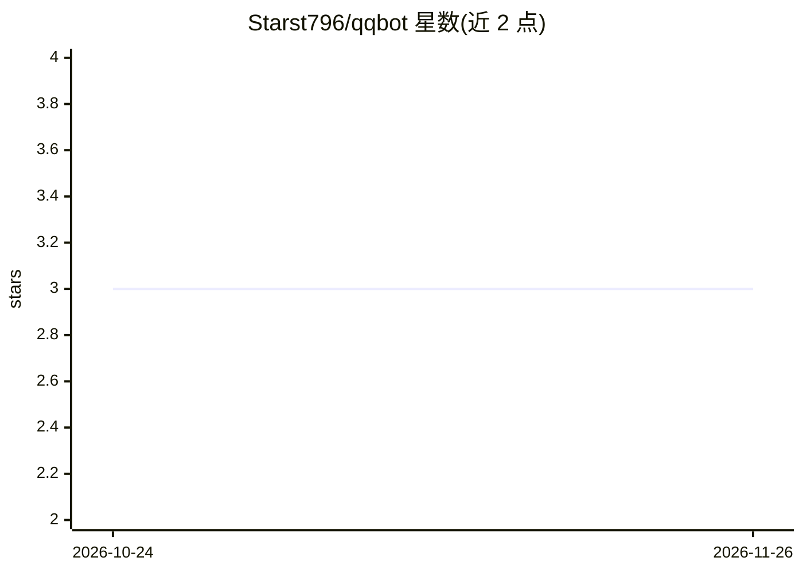

# Starst796/qqbot

⭐ 3 · Python · MIT · 推送 2026-10-24 · [GitHub](https://github.com/Starst796/qqbot) · 个人维护 · 中文 README

**自建 QQ 群聊 AI 机器人：接入 DeepSeek 回复群消息**

在 Linux 服务器上自建 QQ 群聊机器人的方案：NapCatQQ（Docker）托管 QQ 账号提供 OneBot 11 协议，NoneBot2 通过 systemd 运行并接入 DeepSeek。支持 @ 触发或语义接话判定两种触发方式、消息图片内联给模型读图、SerpAPI/SauceNAO 识图工具、基于 embedding 的群消息语义检索与接话对风格蒸馏、不调用模型的学习型复读、三层限流，以及带 BasicAuth 的 nginx 管理面板在线调参。部署依赖 Docker、Python venv 与 nginx/certbot 配置。

## 筛选速览

| 维度 | 判定 | 备注 |
|---|---|---|
| AI 角色 | `ai-native` | 本体是模型或模型工具 |
| 许可风险 | `permissive` | MIT |
| 部署形态 | `self-host` | docker 或自建部署 |
| 模型依赖 | locked-api |  |
| 硬件要求 | — | 无带数字的原话,不猜 |
| 安装摩擦 | `low` | 无编译、无系统依赖或容器化 |
| 成熟度 | — | 结构信号不足 |

## 能力要点

- 群消息落库后经 embedding 语义检索/接话对蒸馏作 few-shot 学习群体语气
- 学习型复读（跟读、学舌接话、接话对直发）不调用模型
- function calling 工具：时间、Tavily 兼容联网搜索、群语料语义检索
- 管理面板支持热改配置、表情包审核、二维码登录排障与私聊数据管理

## 适用场景

- 在自建服务器上部署一个能读群聊语境并模仿群体语气的 QQ 群聊机器人
- 让机器人识别群友发的图片并搜索出处/账号
- 按群粒度开关功能并限流，控制模型调用成本

## 场景标签

`聊天机器人` · 领域:对话与助手

## 证据(README 行号)

> L3: 在一台 Linux 服务器上自建一个 QQ 群聊 AI 机器人（下文以 `user@your-server` 指代）：
> L6: - **NoneBot2**（systemd + venv）连接 OneBot，接入 **DeepSeek `deepseek-flash`**；
> L12: - **风格注入**：全量落库群消息 → embedding 语义检索 / **接话对蒸馏** → 作为 few-shot 学习群体语气；

## 星数曲线

2026-10-24 3 → 2026-11-26 3（+0）

---
*卡片 v1 · prompt 1.4 · 生成 2026-11-22 · 置信度 high · 依据 README sha `8e0aa0c3ee37` · [字段定义](../../DATASET.md)*
