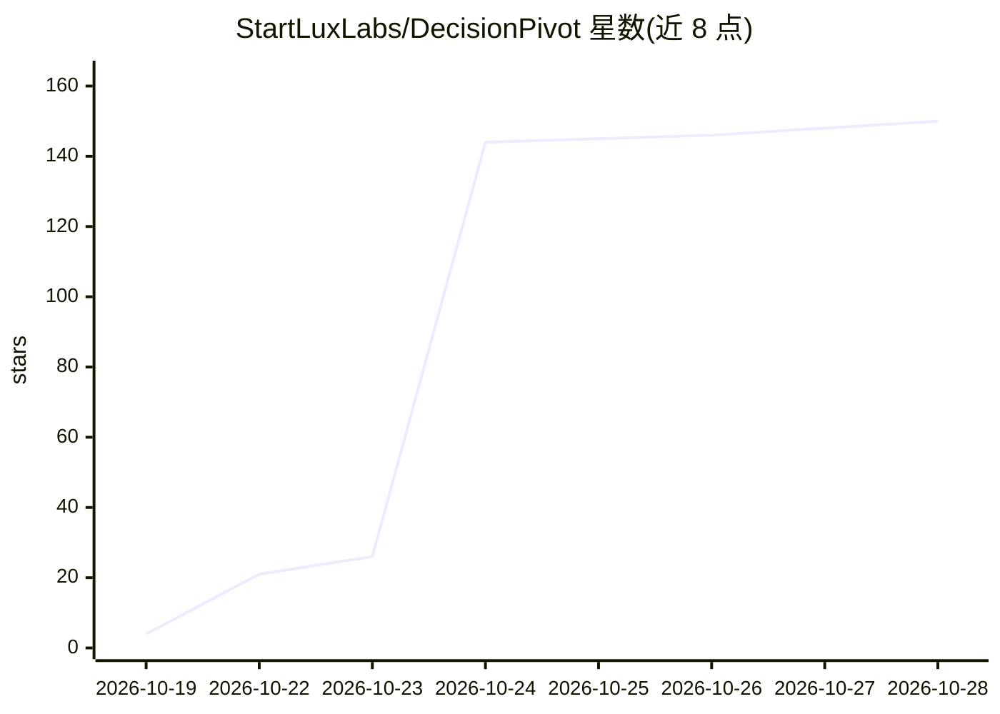

# StartLuxLabs/DecisionPivot

⭐ 150 · Python · Apache-2.0 · 推送 2026-10-21 · [GitHub](https://github.com/StartLuxLabs/DecisionPivot) · [官网](https://huggingface.co/datasets/startlux-models/DecisionPivot) · 组织维护

**评测 LLM 系统中决策模型的诊断基准（对比组+独立求解器）**

DecisionPivot（原名 DecideBench）是评测 LLM 系统控制点上决策模型的基准：模型读入状态与带固定选项的类型化问题，一次前向返回各选项概率。基准含核心赛道（13 个程序生成题族、7,800 题、以仅差一个关键细节的对比组构成）与参考赛道（35 个公开测试集转换），主指标覆盖准确率、对组准确率、5% 错误率下自动化率与校准误差。仓库提供生成器、独立求解器、审计脚本、runner 与 scorer；条目经 Hugging Face 门控数据集分发，仅限评测用途，禁止用于训练。Python 3.9+ 标准库即可运行，可选 numpy/pyarrow/huggingface_hub。

## 筛选速览

| 维度 | 判定 | 备注 |
|---|---|---|
| AI 角色 | `ai-ecosystem` | LLM/agent 周边工具 |
| 许可风险 | `permissive` | Apache-2.0 |
| 部署形态 | `library` | 以包/库形式分发 |
| 模型依赖 | — | README 未给出锁定关系 |
| 硬件要求 | — | 无带数字的原话,不猜 |
| 安装摩擦 | `low` | 无编译、无系统依赖或容器化 |
| 成熟度 | — | 结构信号不足 |

## 能力要点

- 对比组设计：同案例植入一个改变答案的细节，度量对组准确率
- 每题族由未读生成器的第二作者编写独立求解器交叉验证答案
- 核心条目可从种子重新生成并与发布版 SHA-256 哈希比对
- 支持更换种子生成密封新题集，防止公开条目泄漏

## 适用场景

- 评测用于路由、护栏、输出检查等控制点的决策模型
- 对比表面匹配与真实推理：用对组准确率识别只看表象的模型
- 在固定错误率下测模型可接管的自动化工作量

## 场景标签

`模型评测` · 领域:评测与运维

## 证据(README 行号)

> L16: A *decision model* reads a case, the *state*, and a typed question with a fixed set of options, and returns a proba
> L21: This repository holds the code of the benchmark: the generators and independent solvers of the core track, the audi
> L57: **Selective decisions.** A system acts on the probability a decision model returns. The scorer therefore also repor

## 星数曲线

2026-10-19 4 → 2026-10-28 150（+146）

---
*卡片 v1 · prompt 1.4 · 生成 2026-10-23 · 置信度 mid · 依据 README sha `63a367e8c407` · [字段定义](../../DATASET.md)*
