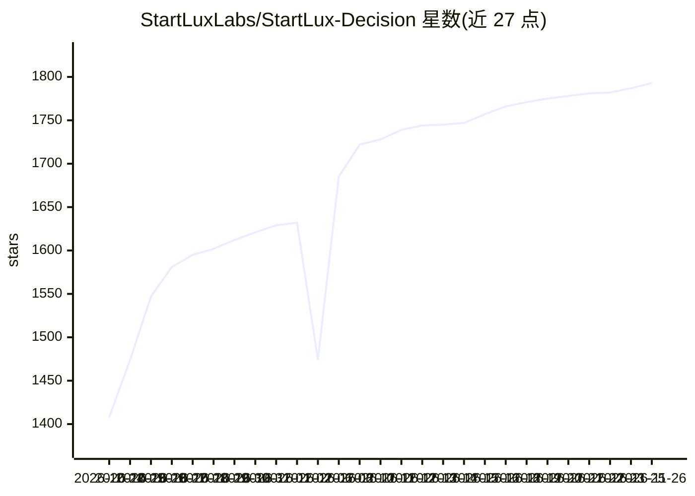

# StartLuxLabs/StartLux-Decision

⭐ 1,793 · Python · Apache-2.0 · 推送 2026-10-23 · [GitHub](https://github.com/StartLuxLabs/StartLux-Decision) · [官网](https://decision.startlux.com/) · 组织维护

**0.8B–27B 开放决策模型家族及推理引擎：一次前向输出每选项概率**

StartLux-Decision 是开放权重决策模型家族与本仓库提供的推理引擎及 HTTP 服务器。给定文本、JSON 或图像状态与类型化问题（choice/noul/score），模型为每个选项返回概率：Instant 模型单次前向作答；AutoThink 模型在最高概率低于 gate（默认 0.6）时生成短推理后再次读取答案。API 兼容 /v1/systemone。引擎支持 vLLM、StartLux-Prism、llama.cpp、MLX 等后端，提供 bench/eval/quantize 工具与 GGUF、MLX、FP8 量化构建。代码 Apache 2.0，权重另行发布。

## 筛选速览

| 维度 | 判定 | 备注 |
|---|---|---|
| AI 角色 | `ai-native` | 本体是模型或模型工具 |
| 许可风险 | `permissive` | Apache-2.0 |
| 部署形态 | `library` | 以包/库形式分发 |
| 模型依赖 | local-ok | 支持本地模型 |
| 硬件要求 | — | 无带数字的原话,不猜 |
| 安装摩擦 | `medium` | 含编译或系统依赖之一 |
| 成熟度 | — | 结构信号不足 |

## 能力要点

- 类型化问题接口：choice/noul/score 三种题型均输出概率分布
- AutoThink 双路径：置信门控（gate）决定是否生成短推理
- none_probability 控制项检测"选项均不适用"的情形
- 多引擎矩阵：vLLM/Prism/llama.cpp/MLX/transformers，支持 GGUF 与 MLX 量化构建

## 适用场景

- 为游戏或机器人决策流实时输出每选项概率
- 客服工单分类等需要概率而非纯文本答案的判定
- 在 Apple Silicon 或无 vLLM 的机器上通过 llama.cpp/MLX 运行模型

## 场景标签

`推理引擎` `模型量化` `模型评测` · 领域:评测与运维

## 证据(README 行号)

> L14: StartLux-Decision is a family of open decision models. Given a state (text, JSON or images) and a set of typed
> L20: This repository contains the inference engine and HTTP server for both variants. The API is compatible with System
> L78: On NVIDIA GPUs, StartLux-Prism is our inference engine written for

## 星数曲线

2026-10-24 1,408 → 2026-11-26 1,793（+385）

---
*卡片 v1 · prompt 1.4 · 生成 2026-11-23 · 置信度 high · 依据 README sha `c7ab301e86c2` · [字段定义](../../DATASET.md)*
